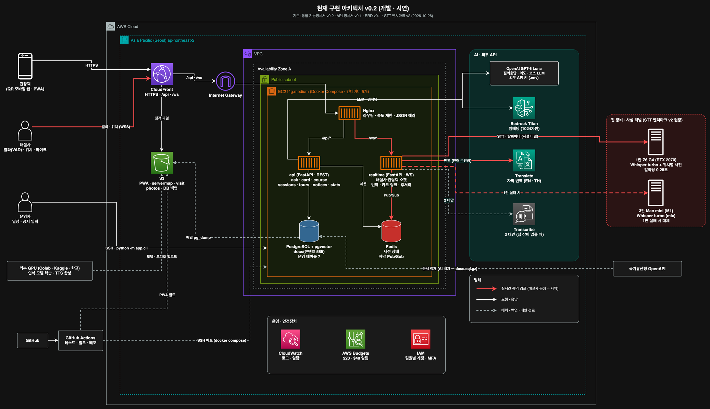
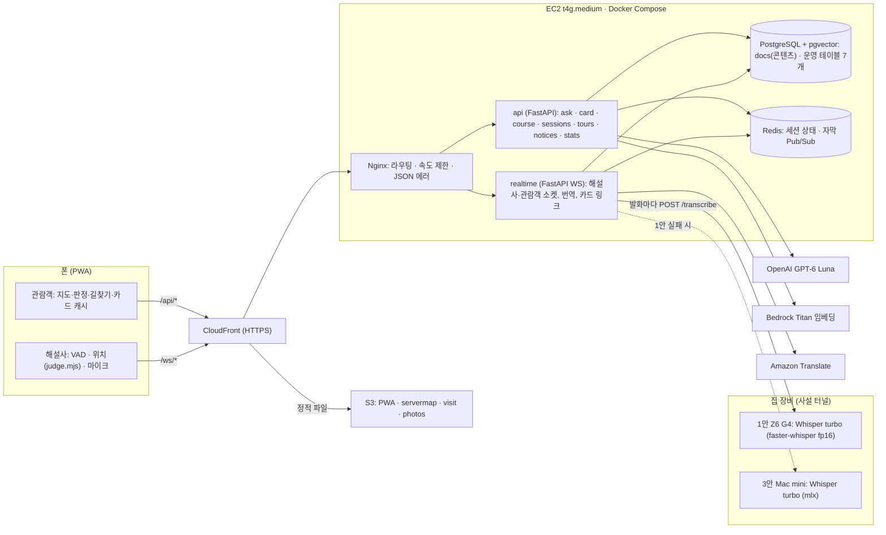
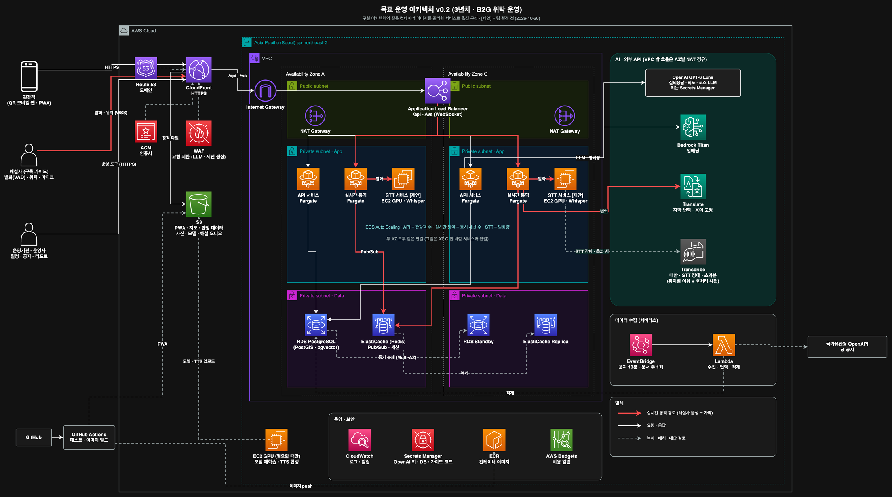

# 宮今 학기 중 구현 아키텍처 (v0.2)

- 작성: 김병진 (BE) · 2026-10-26
- 기준 문서: 통합 기능명세서 v0.2 · API 명세서 v0.1 · ERD v0.1 · STT 벤치마크 결과 보고서 v2 · 팀 저장소 `deploy/` (커밋 `0c7d687`)
- 이전 버전: 최종 제안서 6장 (6.3 학기 중 구현 아키텍처)

이 문서는 제안서 6장 이후 바뀐 결정을 아키텍처와 BE 코드에 반영한 결과입니다. 바뀌지 않은 원칙(무거운 처리는 폰과 CDN, 서버는 통역과 질의응답, 익명·무저장)은 그대로입니다.

## 1. 제안서 6장 대비 바뀐 것

| 항목 | 제안서 6장 | 지금 (v0.2) | 근거 |
|---|---|---|---|
| 질의응답·코스 LLM | Amazon Bedrock (Claude) | **OpenAI GPT-6 Luna** (`OPENAI_API_KEY`) | 기능명세서 v0.2, deploy |
| 임베딩 | (pgvector) | Bedrock Titan v2, 1024차원 | 기능명세서 v0.2, ERD 2.2 |
| RAG 흐름 | 검색 → 답변 | 의도 분류 → 한국어로 옮겨 검색(벡터+키워드) → LLM 이 근거 최대 8개 선택 → 답변 | 기능명세서 v0.2 T-41 |
| 실시간 음성 인식 | Amazon Transcribe 스트리밍 | **집 서버 Whisper large-v3-turbo + 위치별 받아쓰기 사전** (1안), Mac mini 대체 (3안) | STT 벤치마크 v2 4.3 |
| 고유명사 교정 | 사전 매칭 + 퍼지 매칭 | 위치별 **받아쓰기 사전**(Whisper prompt)이 기본. 후처리 사전(자모 Jaro-Winkler 0.85)은 약한 엔진(Transcribe)일 때만 | STT 벤치마크 v2 4.1 |
| 지원 언어 | 영어 + 2차(베·태·인니 중 1) | **영어 · 태국어** (+ 한국어 콘텐츠) | 기능명세서 v0.2 (10/7 회의) |
| 앱 ↔ 서버 언어 코드 | — | `ko` · `en` · `th` (서버가 팀 로직의 '한국어'·'English'·'ภาษาไทย' 와 변환) | API 명세서 v0.1 |
| 길찾기 | 폰 A* | 폰 다익스트라 (`route.mjs`, `paths.geojson`) | 기능명세서 v0.2 T-16 |
| 방문 판정 | 폴리곤·반경 진입 | 판정 존 48개, 7초 → 해설, 25초 → 스탬프 (`judge.mjs`) | 기능명세서 v0.2 T-13 |
| 코스 추천 | 칩 → 서버 그래프 최적화 | 자유 문장 → LLM 2회 → 폰 `fitCourse` 가 실제 시간으로 맞춤 | 기능명세서 v0.2 T-15 |
| 서버 구성 | Nginx · API · 실시간 통역 · PostgreSQL · Redis | 같음 + **집 STT 서버**(EC2 밖) | — |

## 2. 구성도

원본: [`diagrams/architecture-v0.2.drawio`](diagrams/architecture-v0.2.drawio) (draw.io 로 열어 수정). 다시 만들기: `python3 docs/diagrams/build_architecture.py`

같은 내용의 텍스트 구성도:

**제안서 그림(draw.io)에서 고칠 곳**
1. AI Services 박스: `Bedrock (Claude) RAG 질의응답` → `OpenAI GPT-6 Luna (외부 API)` + `Bedrock Titan 임베딩`, `Transcribe 실시간 음성인식` → 점선(대안) 표시
2. EC2 밖에 **집 장비(Z6 G4 · Mac mini)** 박스 추가, `실시간 통역` 컨테이너에서 화살표 "STT (사설 터널)"
3. `외부 GPU (Colab·Kaggle·학교)` 박스는 학습·TTS 용도로 그대로 둠 (실시간 STT 와 별개)

## 3. 실시간 통역 흐름 (제안서 6.4 갱신)

| 단계 | 처리 위치 | 내용 | 예상 시간 |
|---|---|---|---|
| 1 | 해설사 폰 | VAD 로 발화 하나를 자름 → WebSocket binary 프레임 1개 (WebM/Opus ≈ 23KB / 7.6초) | 발화 끝 + 업로드 |
| 2 | realtime | 해설사 현재 위치의 사전으로 prompt 생성 (`경복궁 해설입니다. 흥례문, 영제교.`) | ~0 |
| 3 | 집 서버 | Whisper turbo 받아쓰기 (1안 실패 시 3안) | 0.28초 (Z6 G4) / 1.61초 (Mac mini) |
| 4 | realtime | (Transcribe 일 때만) 후처리 사전 | 0.5ms |
| 5 | Translate | 참여 언어마다 1번 (사람 수 아님) | 0.2~0.4초 |
| 6 | Redis → WS | 언어별 자막 + 카드 링크, 해설사에게 인식 문장 미리보기 | ~0.1초 |

- 발화 단위라 자막은 **해설사가 한 문장을 끝낸 뒤** 나옵니다 (스트리밍처럼 말하는 도중 나오지 않음). 벤치마크 발화 길이 4~13초.
- 측정: 이 Mac(Apple Silicon, mlx)에서 실제 한국어 음성 4.5초 → 자막까지 2.03초 (번역 제외). Z6 G4 는 보고서 기준 STT 0.28초라 1초 안쪽 예상.
- 위치별 사전 효과 (같은 측정): 사전 없이 `흥예문`·`영재교` → 사전 넣고 `흥례문`·`영제교`.

## 4. 해설사 폰(FE)이 지켜야 할 것

| 항목 | 내용 |
|---|---|
| 오디오 | 발화 하나 = binary 프레임 하나. WebM/Opus 권장 (WAV 16kHz 16bit 도 됨). 2MB 이하 |
| 위치 | 판정 존에 들어갈 때마다 `{"type":"location","poiId":"place:..."}` (`pois.json` id). 위치를 모르면 사전 없이 받아씀 → 전각명 인식률 하락 |
| 마이크 | 켜고 끌 때 `{"type":"mic","on":true/false}` → 관람객 S-04 |
| 연결 유지 | 30초마다 `{"type":"ping"}` (CloudFront·Nginx 유휴 끊김 방지) |
| 관람객 재연결 | 다시 붙으면 `{"type":"resume","lastSeq":N}` → 놓친 구간은 `gap` 으로만 옴 (재전송 없음) |

## 5. 집 서버 연결

- EC2 → 집 서버는 공유기 포트를 열지 않고 사설 터널(Tailscale·WireGuard·Cloudflare Tunnel 중 택1)로 연결합니다. `STT_HTTP_URLS` 에 1안·3안 주소를 순서대로 넣으면 앞이 실패할 때 다음으로 넘어갑니다.
- 둘 다 실패하면 해설사 화면에 "음성 인식 연결에 실패했습니다"가 한 번 뜹니다. 클라우드로 바로 넘어가는 자동 전환은 아직 없습니다 (`STT_PROVIDER=transcribe` 로 바꿔 다시 띄우면 2 대안).
- 집 서버는 음성을 디스크에 쓰지 않고 메모리에서 처리합니다 (G-01 "NOT stored").

## 6. 데이터 저장 위치 (ERD v0.1 반영)

| 저장 위치 | 담는 것 | 상태 |
|---|---|---|
| PostgreSQL `docs` | 전각 문단·용어집 585개 + Titan 임베딩 (팀 로직이 씀) | 팀 deploy 그대로. ERD 2절의 `building`·`building_paragraph`·`term` 3테이블 구조는 역설계 초안이라 실제 DB 와 다름 (ERD E1) |
| PostgreSQL 운영 테이블 | `live_session` · `session_language` · `session_card_mention` · `tour_schedule` · `notice` · `notice_translation` · `visit_stat` | 구현 (처음 요청 때 자동 생성) |
| Redis | `session:{code}` (status · micOn · startedAt · guideName · location), listeners · peak · cards · seq, 언어별 채널 | 구현. 재전송 버퍼(`buffer:{lang}`)는 두지 않음 (17-3 제안안) |
| S3 | PWA · `servermap/` · `visit/` (pois · 판정 존) · `photos/` | 팀 deploy |
| 기기 | 언어 · 판정 상태 · 카드 캐시 | FE |

## 7. 비용

다시 계산한 결과는 [`COST.md`](COST.md). 요약: 학기 중 약 17만(제안서 23만), 운영 월 109만 / 226만 / 356만(제안서 184 / 376 / 733만), 매출 대비 18% / 16% / 12%.
음성 인식이 클라우드 종량제에서 GPU 고정비로 바뀌고 LLM 단가가 낮아져 줄었으며, 대신 번역(Translate)이 가장 큰 항목이 됩니다.

## 8. 남은 결정 (BE 관점)

| # | 내용 | 관련 |
|---|---|---|
| 1 | `GUIDE_ACCESS_CODE` 운영 값과 배포 방식 | 기능명세서 17-1 |
| 2 | 위치별 사전 파일: 원본 `hints_by_location.json` 키(녹음 ID별)를 `pois.json` id 로 바꾸는 담당·시점 | STT v2, 이 문서 4절 |
| 3 | 해설 위치 26곳(STT 사전)과 판정 대상 71곳(`judge.mjs`)의 대응 — 붙어 있는 위치는 사전을 합쳐야 함 | STT v2 2.4 |
| 4 | 집 서버 터널 방식과 장비 상시 가동 여부 | 이 문서 5절 |
| 5 | 2 대안(Transcribe)으로 자동 전환할지 | 이 문서 5절 |
| 6 | 콘텐츠 DB 를 ERD 3테이블 구조로 바꿀지, 지금 `docs` 1테이블을 유지할지 | ERD E1 |

## 9. 목표 운영 아키텍처 (3년차 · B2G)

원본: `diagrams/architecture-v0.2.drawio` 의 2쪽. 구현 아키텍처와 같은 컨테이너 이미지를 관리형 서비스로 옮긴 구성입니다 (제안서 6.6 전환 방식 그대로).

| 구성 | 구현 (v0.2) | 목표 운영 | 바뀐 이유 |
|---|---|---|---|
| 입구 | CloudFront 기본 주소 | Route 53 + ACM 도메인, **WAF**(LLM · 세션 생성 요청 제한) | 정식 서비스 · 익명 서비스 비용 방어 |
| API · 실시간 통역 | EC2 한 대의 컨테이너 | **ECS Fargate** 서비스 2개, AZ 2개, ALB(WebSocket) 뒤 | 가용성 · 부하 성격별 확장 |
| 음성 인식 | 집 서버 Whisper (1안) · Mac mini (3안) | **[제안] STT 서비스: EC2 GPU 에서 같은 Whisper turbo + 위치별 사전**, AZ 별 · Auto Scaling. 장애 · 초과분은 Transcribe(위치별 어휘 + 후처리 사전) | B2G 운영에 집 장비는 못 씀. 3년차 통역량이면 자체 GPU 가 클라우드 STT 보다 쌀 가능성 (STT 벤치마크 v2 정확도 기준 유지) |
| LLM | OpenAI GPT-6 Luna (`.env` 키) | 같음. 키는 **Secrets Manager**, 호출은 AZ별 NAT 경유 | — |
| DB · 캐시 | PostgreSQL · Redis 컨테이너 | **RDS PostgreSQL Multi-AZ**(PostGIS · pgvector), **ElastiCache** 복제본 | 데이터센터 장애 대비 |
| 데이터 수집 | 운영자 CLI · AI 배치 | **EventBridge + Lambda** (공지 10분 · 문서 주 1회) | 상시 서버 불필요 |
| 학습 · TTS | 외부 GPU (Colab 등) | EC2 GPU 필요할 때만 | 재학습 정기화 시 |

[제안] STT 서비스는 팀 결정 전입니다. 대안은 (1) 처음부터 클라우드 STT(Transcribe 2 대안 또는 CLOVA 2안)만 쓰는 것, (2) 학기 후에도 집 장비를 쓰는 것(B2G 가용성 요건 때문에 권장하지 않음)입니다. GPU 인스턴스 비용과 3년차 통역 분량을 같이 놓고 정해야 합니다.
