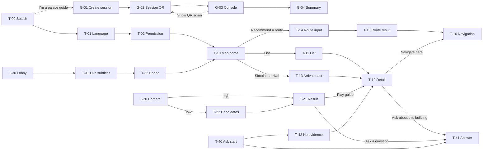

# GungGeum(宮今) 프로토타입 기능 명세서

- 버전: v0.1 (초안)
- 작성일: 2026-10-06
- 작성: Team APEX
- 기준: Figma Make 스켈레톤 프롬프트 (4단계)

경복궁을 찾는 외국인 개별 관광객용 모바일 웹앱(PWA)의 화면별 기능 명세입니다. 관광객은 QR로 바로 들어오고 회원가입이나 로그인이 없습니다. 각 화면에 제안서 요구사항(F·N 번호)과 서버 처리 위치(기기 / API / WS)를 함께 적어, 프론트엔드와 백엔드가 같은 문서로 작업 범위를 나눌 수 있게 했습니다.

> 표기 규칙: **[확인 필요]** = 프롬프트에 정의되지 않아 팀 결정이 필요한 부분, **[제안]** = 작성자가 제안하는 동작

| 화면·상태 | MVP 대상 | 화면 그룹 | 지원 언어 |
| --- | --- | --- | --- |
| 31개 (컴포넌트 포함) | 12개 | 8개 | EN 활성, VI·TH·ID 예정 |

---

## 1. 범위와 원칙

| 항목 | 내용 |
| --- | --- |
| 사용자 | ① 관광객 (외국인 개별 관광객, 익명) ② 궁 해설사 (한국어 해설, 가이드 모드) |
| 진입 | 관광객: QR 스캔 → T-00 / 해설사: T-00의 `I'm a palace guide` 링크 → G-01 |
| 계정 | 없음. 관광객은 익명 세션 토큰, 해설 세션은 세션 코드(예: `GB-1042`)로 참여 (N1, N2) |
| 언어 | UI 문구는 영어. 언어 선택에서 English만 활성, Tiếng Việt·ไทย·Bahasa Indonesia는 "Coming soon" (N3) |
| 범위 밖 | 회원가입·로그인, 결제, 한복 대여 연동, 관리자(운영기관) 화면 |

### 설계 원칙 (프로토타입에 반영된 것)

- **무가입·즉시 사용:** 첫 화면에 "No sign-up needed"를 명시하고 3단계(Splash → 언어 → 권한) 안에 지도에 도착합니다.
- **고유명사 일관성:** 해설·자막·답변에 나오는 전각·인물·유물 이름은 모두 같은 강조 스타일(빨간 밑줄)이고, 탭하면 같은 Proper Noun Card가 열립니다. (F9, N5)
- **오프라인 우선:** 지도, 오디오 가이드, 카메라 인식은 네트워크 없이 동작하고, 라이브 투어와 질의응답만 연결이 필요합니다. (S-01)
- **긴 번역문 대응:** 모든 레이아웃은 flex/auto-layout으로, 태국어·베트남어·인도네시아어처럼 긴 문장에서도 깨지지 않아야 합니다.

---

## 2. 공통 UI

| 요소 | 구성 | 동작 | 노출 조건 |
| --- | --- | --- | --- |
| Top bar | 로고 "GungGeum", 언어 칩 `EN ▾`, 공지 벨, 여권(스탬프) 아이콘 | 언어 칩 → T-01 / 벨 → T-50 / 여권 → T-51 | 관광객 화면 전체 (T-00~T-02 제외) |
| Bottom tab bar | Map · Scan · Live Tour · Ask | 탭 → T-10 / T-20 / T-30 / T-40, 활성 탭은 빨간색 | 관광객 메인 화면, 가이드 모드에서는 숨김 |
| Mini audio player | 전각명, 재생/일시정지, 진행 바, 닫기 | 탭 전환 중에도 유지, 닫기 → 재생 중지 후 숨김 | 오디오 재생 중일 때 탭 바 위에 고정 |
| Screen ID tag | 좌상단 작은 회색 ID (예: `T-10`) | 없음 (리뷰용) | 프로토타입 전용, 실제 빌드에서 제거 |
| Screen Index | 좌하단 `☰ Screens` 버튼 → 그룹별 화면 목록, MVP 배지 | 항목 클릭 → 해당 화면으로 이동, 예외 상태(S-xx)도 여기서 켬 | 프로토타입 전용 |

### 시각 규칙

- 프레임 390×844, 회색조(#FFFFFF, #F2F2F2, #D9D9D9, #9E9E9E, #333) + 강조색 하나(#C8102E). 강조색은 주요 버튼, 활성 탭, 고유명사에만 씁니다.
- 이미지는 대각선 X가 그려진 회색 박스와 라벨(예: `[Photo: Geunjeongjeon]`), 아이콘은 선 아이콘입니다.

---

## 3. 화면 목록

처리 위치: **기기** = 폰·CDN에서 처리(서버 호출 없음) / **API** = API 서비스 컨테이너 / **WS** = 실시간 통역 컨테이너(WebSocket)

| ID | 화면 | 그룹 | MVP | 요구사항 | 처리 위치 |
| --- | --- | --- | --- | --- | --- |
| T-00 | Splash | 온보딩 |  | N1 N2 | 기기 |
| T-01 | Language select | 온보딩 |  | N3 | 기기 |
| T-02 | Permission guide | 온보딩 |  | F3 | 기기 |
| T-10 | Map home | 지도·오디오 | MVP | F1 F3 F6 | 기기, API |
| T-11 | Building list | 지도·오디오 | MVP | F3 | 기기 |
| T-12 | Building detail | 지도·오디오 | MVP | F3 F4 F9 | 기기 |
| T-13 | Arrival toast | 지도·오디오 |  | F3 | 기기 |
| T-14 | Route input | 지도·오디오 |  | F2 | 기기 |
| T-15 | Route result | 지도·오디오 |  | F2 | API |
| T-16 | Navigation | 지도·오디오 | MVP | F1 | 기기 |
| T-20 | Camera viewfinder | 스캔 |  | F10 | 기기 |
| T-21 | Single result | 스캔 |  | F10 | 기기 |
| T-22 | Low-confidence result | 스캔 |  | F10 | 기기 |
| T-30 | Live Tour lobby | 라이브 투어 |  | F8 N2 | API |
| T-31 | Live subtitle view | 라이브 투어 | MVP | F8 F9 N4 N5 | WS |
| T-32 | Session ended | 라이브 투어 |  | F8 F9 | API |
| T-40 | Ask start | 질의응답 | MVP | F5 | 기기 |
| T-41 | Chat answer | 질의응답 | MVP | F5 F9 | API |
| T-42 | No-evidence answer | 질의응답 | MVP | F5 | API |
| T-50 | Notices | 부가 기능 |  | F6 | API |
| T-51 | Digital passport | 부가 기능 |  | F7 | 기기 |
| G-01 | Create session | 가이드 모드 | MVP | F8 N2 | API |
| G-02 | Session QR | 가이드 모드 | MVP | F8 N1 | API |
| G-03 | Live session console | 가이드 모드 | MVP | F8 N4 | WS |
| G-04 | Session summary | 가이드 모드 |  | F8 | API |
| S-01 | Offline banner | 예외 상태 |  | — | 기기 |
| S-02 | Subtitle reconnecting | 예외 상태 |  | F8 | WS |
| S-03 | Weak GPS | 예외 상태 |  | F3 | 기기 |
| S-04 | Guide mic off | 예외 상태 |  | F8 | WS |
| S-05 | Camera permission denied | 예외 상태 |  | F10 | 기기 |
| PNC | Proper Noun Card (bottom sheet) | 공통 컴포넌트 | MVP | F9 N5 | 기기 |

---

## 4. 화면 흐름

주요 이동만 표시했습니다. 탭 바와 Top bar 아이콘으로는 어느 메인 화면에서든 이동할 수 있습니다.

---

## 5. 온보딩

### T-00 Splash

`N1 N2` · 처리 위치: 기기

QR로 들어온 관광객에게 서비스 정체성과 "가입 없음"을 바로 알립니다.

- **진입:** QR 스캔으로 연 URL, 앱 첫 실행
- **구성:** 로고, 태그라인 "Your palace guide in your language", "No sign-up needed", `Start` 버튼, 작은 링크 `I'm a palace guide`
- **동작:**
    - `Start` → T-01
    - `I'm a palace guide` → G-01 (가이드 모드, 탭 바 없음)
- **비고:** 재방문 시(언어·권한 설정 완료) 바로 T-10으로 보낼지 **[확인 필요]** → 16-9

### T-01 Language select

`N3` · 처리 위치: 기기

이후 모든 해설·자막·답변·공지의 언어를 정합니다.

- **진입:** T-00 Start, Top bar 언어 칩
- **구성:** 언어 목록: English (활성), Tiếng Việt / ไทย / Bahasa Indonesia ("Coming soon", 비활성)
- **동작:**
    - English 선택 → T-02 (온보딩 중) 또는 이전 화면 복귀 (언어 칩으로 진입 시)
    - 비활성 언어는 탭되지 않음
- **데이터:** 선택 언어를 기기에 저장, 이후 API·WS 요청에 언어 코드 포함

### T-02 Permission guide

`F3` · 처리 위치: 기기

위치 권한을 왜 쓰는지 먼저 설명한 뒤 브라우저 권한 요청을 띄웁니다.

- **구성:** 설명 "location is used for auto-playing audio guide", `Allow location`, `Not now`
- **동작:**
    - `Allow location` → 브라우저 위치 권한 요청 → T-10
    - `Not now` → T-10 (현재 위치 점 없음, 도착 알림 꺼짐)
- **예외:** 권한 거부 시 T-10에서 위치 기능 없이 사용, 목록(T-11)으로 해설 선택

---

## 6. 지도·오디오 가이드

### T-10 Map home (MVP)

`F1 F3 F6` · 처리 위치: 기기, API

궁 안 위치와 전각을 보여 주는 관광객 메인 화면입니다.

- **진입:** 온보딩 완료, Map 탭, T-32 `Back to map`
- **구성:**
    - 회색 지도 플레이스홀더 + 전각 핀 12개 (절대 위치)
    - 파란 "you are here" 점
    - 상단 공지 배너 "Today 14:00 English tour cancelled due to rain"
    - 플로팅 `Recommend a route`, `List` 토글, `Simulate arrival` (프로토타입 전용)
- **동작:**
    - 핀 탭 → T-12 **[확인 필요]**
    - `List` → T-11
    - `Recommend a route` → T-14
    - 공지 배너 탭 → T-50
    - `Simulate arrival` → T-13 토스트
- **예외:** S-01 오프라인 배너, S-03 GPS 약함
- **실제 구현:** MapLibre GL + PMTiles(S3·CloudFront), Geolocation API. 공지 배너만 API 호출

### T-11 Building list (MVP)

`F3` · 처리 위치: 기기

지도 대신 목록에서 전각을 찾고 해설을 고릅니다. GPS가 안 될 때의 대체 경로이기도 합니다.

- **진입:** T-10 List, S-03 / S-05의 대체 버튼
- **구성:** 검색창, 전각 카드 (썸네일 박스, 이름, 분류, 거리, 오디오 길이)
- **동작:**
    - 검색어 입력 → 이름(영문·한글) 기준 실시간 필터
    - 카드 탭 → T-12
- **상태:** 검색 결과 없음 문구 **[확인 필요]**. 위치 권한이 없으면 거리 표시 숨김
- **데이터:** Building 목록 (정적 JSON, CDN 캐시)

### T-12 Building detail (MVP)

`F3 F4 F9` · 처리 위치: 기기

한 전각의 현지화 해설(텍스트·오디오)을 제공하고, 길찾기와 질문으로 이어 줍니다.

- **진입:** T-10 핀, T-11 카드, T-13 토스트, T-21 Play guide, PNC Open building guide, T-42 관련 카드
- **구성:** 대표 사진 박스, 영문명 + 한글명, `Play audio guide`, 현지화 설명문, `Navigate here`, `Ask about this building`
- **동작:**
    - `Play audio guide` → 재생 시작, Mini player 표시
    - 설명문 속 고유명사(King Sejong, Irworobongdo, Eojwa throne) 탭 → PNC
    - `Navigate here` → T-16 (목적지 = 이 전각)
    - `Ask about this building` → T-41 (전각명 프리필)
- **실제 구현:** 설명문·오디오는 미리 생성한 파일(LLM 원고 → 검수 → TTS 배치 합성)을 CDN에서 받음. 재생은 서버 호출 없음

### T-13 Arrival toast

`F3` · 처리 위치: 기기

관광객이 전각에 도착하면 해설 재생을 제안합니다.

- **구성:** T-10 위 토스트 "You've arrived at Geunjeongjeon ▶ Play guide"
- **동작:**
    - 토스트의 Play guide 탭 → 해설 재생 (T-12로 이동할지, 지도에 머물며 Mini player로 재생할지 **[확인 필요]**)
    - 일정 시간 뒤 자동 사라짐 (시간 **[확인 필요]**)
- **프로토타입:** T-10의 `Simulate arrival` 버튼으로 발생
- **실제 구현:** GPS 좌표가 전각 폴리곤·인식 반경 안에 들어오면 발생. 같은 전각은 한 번만 알림. 방문 여권(T-51) 스탬프도 이때 기록

### T-14 Route recommendation input

`F2` · 처리 위치: 기기

가용 시간과 관심사를 받아 맞춤 동선을 만듭니다.

- **구성:** 가용 시간 칩 (30 / 60 / 90+ min, 단일 선택), 관심사 칩 (Architecture, Royal life, Gardens, History, 복수 선택), `Create route`
- **동작:** `Create route` → T-15
- **검증:** 시간 미선택 시 버튼 비활성 여부 **[확인 필요]**

### T-15 Recommended route result

`F2` · 처리 위치: API

추천 경유지와 이동 시간을 보여 줍니다.

- **구성:** 번호 매긴 경유지 목록, 구간별 도보 시간, 총 소요 시간, `Start navigation`
- **동작:**
    - `Start navigation` → T-16 (첫 경유지부터)
    - 경유지 탭 → T-12 **[제안]**
- **실제 구현:** API 서비스의 동선 추천 (관심사 가중치 + 보행로 그래프 최적화)

### T-16 Navigation in progress (MVP)

`F1` · 처리 위치: 기기

궁 안 도보 길안내입니다.

- **진입:** T-15 Start navigation, T-12 Navigate here
- **구성:** 경로선이 그려진 지도 플레이스홀더, 상단 안내 카드 "Walk 120m to Sajeongjeon", 다음 경유지, `End`
- **동작:**
    - `End` → T-10
    - 경유지 도착 → T-13 토스트, 다음 경유지로 안내 갱신
- **실제 구현:** OSM 보행로 그래프(319개 구간)로 기기에서 A* 탐색. 서버 호출 없음

---

## 7. 스캔 (카메라 전각 인식)

### T-20 Camera viewfinder

`F10` · 처리 위치: 기기

카메라로 비춘 전각이 무엇인지 알려 줍니다.

- **구성:** 어두운 카메라 화면 플레이스홀더, 프레이밍 가이드 사각형, 힌트 "Point your camera at a building", 나침반 방향 표시, 셔터 버튼, 신뢰도 토글 (프로토타입 전용)
- **동작:**
    - 셔터 (토글 High) → T-21
    - 셔터 (토글 Low) → T-22
- **예외:** S-05 카메라 권한 거부
- **실제 구현:** EfficientNet-B0 양자화 모델(10MB 이하)을 기기에서 추론 (TF.js / ONNX Runtime Web). 현재 위치 + 나침반 방향(DeviceOrientation)으로 후보를 좁힘. 사진은 서버로 보내지 않음

### T-21 Single result

`F10` · 처리 위치: 기기

- **구성:** 뷰파인더 위로 올라오는 하단 카드: 사진 박스, "This is Geunjeongjeon", 신뢰도 라벨 "High match", `Play guide`, `Ask a question`
- **동작:**
    - `Play guide` → T-12
    - `Ask a question` → T-41 (전각명 프리필)
    - 카드 닫기 → T-20 **[제안]**

### T-22 Low-confidence result

`F10` · 처리 위치: 기기

확신이 낮을 때 틀린 답을 단정하지 않고 사용자에게 고르게 합니다.

- **구성:** "Which one are you looking at?" + 후보 카드 3개 (Geunjeongjeon / Sajeongjeon / Heungnyemun)
- **동작:** 후보 선택 → 해당 전각의 T-21 또는 바로 T-12 **[확인 필요]**
- **실제 구현:** 1순위 확률이 기준값 미만이면 상위 3개를 보여 줌. 기준값은 평가셋으로 정함

---

## 8. 라이브 투어 (실시간 통역 자막)

### T-30 Live Tour lobby

`F8 N2` · 처리 위치: API

궁의 한국어 정기 해설에 자국어 자막으로 참여하는 입구입니다.

- **구성:** 설명 "Join the palace's Korean guided tour with live subtitles in your language", 오늘 일정 (10:00, 11:00, 13:00, 14:00, 15:00, 16:00 / Upcoming · Live now · Ended), `Scan session QR`, `Join demo session`
- **동작:**
    - `Scan session QR` → QR 스캐너 → T-31
    - `Join demo session` → T-31
    - "Live now" 일정 탭 시 동작 **[확인 필요]**
- **예외:** S-01 오프라인이면 탭 자체가 비활성

### T-31 Live subtitle view (MVP)

`F8 F9 N4 N5` · 처리 위치: WS

해설사의 한국어 설명을 실시간 번역 자막으로 보여 주는 핵심 화면입니다.

- **헤더:** 빨간 점 "LIVE", 가이드 이름 "Guide Kim", 경과 시간, 연결 상태 배지 (Connected / Reconnecting / Offline)
- **자막:**
    - 2~3초마다 새 자막 블록 추가, 자동 스크롤
    - 블록 = 영어 번역 + (토글 시) 작은 회색 한국어 원문
    - 고유명사 강조, 탭 → PNC
    - 누락 표시 "⚠ Some subtitles were missed while reconnecting" 1회
- **하단 제어:** 글자 크기 `A-` `A+`, `Show original Korean` 토글, `Leave`
- **동작:**
    - `Leave` → T-30 또는 T-10 **[확인 필요]** (이탈 확인 단계 여부도 결정)
    - 해설사가 세션 종료 → T-32 자동 이동
    - 사용자가 위로 스크롤하면 자동 스크롤 멈춤, "새 자막" 버튼 표시 **[제안]**
- **예외:** S-02 재연결 중, S-04 해설사 마이크 꺼짐
- **성능 목표:** 해설사 발화부터 자막 표시까지 3초 이내 (N4)

### T-32 Session ended

`F8 F9` · 처리 위치: API

- **구성:** "The tour has ended", 해설 중 언급된 전각 칩 목록, `Back to map`
- **동작:**
    - 전각 칩 → T-12 (또는 PNC)
    - `Back to map` → T-10
- **데이터:** 세션 중 교정된 고유명사 목록 (서버에 자막 원문은 저장하지 않으므로, 용어 ID만 집계)

---

## 9. 질의응답 (RAG)

### T-40 Ask start (MVP)

`F5` · 처리 위치: 기기

- **구성:** 안내 "Ask anything about Gyeongbokgung in your language. Answers are based on official Korea Heritage Service materials.", 추천 질문 칩 3개, 입력창
- **동작:**
    - 추천 칩 탭 → 해당 질문 전송 → T-41
    - 직접 입력 → T-41 또는 T-42
- **추천 질문:** "Why is Gyeonghoeru built on water?" / "Where did the king sleep?" / "What is the painting behind the throne?"

### T-41 Chat answer (MVP)

`F5 F9` · 처리 위치: API

- **진입:** T-40, T-12 Ask about this building, T-21 Ask a question (프리필)
- **구성:** 사용자 말풍선, 봇 답변 (고유명사 강조), 답변마다 Sources 칩 (예: "📄 Gyeonghoeru – Korea Heritage Service"), 입력창 + 전송 버튼
- **동작:**
    - 고유명사 탭 → PNC
    - Sources 칩 탭 → 출처 상세 **[확인 필요]**
    - 추가 질문 전송 → 답변 누적
- **상태:** 답변 생성 중 로딩 표시 **[확인 필요]**. 질문 수 제한 도달 상태 없음 → 16-5
- **실제 구현:** 질문 임베딩 → pgvector 근거 검색 → Bedrock(Claude) 답변. 근거 문서를 Sources로 반환

### T-42 No-evidence answer (MVP)

`F5` · 처리 위치: API

공식 자료에 근거가 없으면 추측하지 않는다는 원칙을 화면으로 보여 줍니다.

- **구성:** 봇 답변 "I couldn't find this in official materials, so I won't guess." + 관련 전각 가이드 카드
- **동작:** 카드 탭 → T-12
- **프로토타입:** 추천 질문 3개 외 모든 입력은 T-42로 응답
- **실제 구현:** 검색 유사도가 기준값 미만이면 LLM을 호출하지 않고 이 응답을 반환 (비용 절감 효과도 있음)

---

## 10. 부가 기능

### T-50 Notices

`F6` · 처리 위치: API

- **진입:** Top bar 벨, T-10 공지 배너
- **구성:** 공지 목록: 유형 태그 (Tour cancelled / Weather / Event change), 시각, 본문. 모두 사용자 언어로 표시
- **상태:** 새 공지가 있으면 벨에 점 표시 **[제안]**, 공지 없음 문구 **[확인 필요]**
- **실제 구현:** 국가유산청·궁 공지를 10분 간격 수집 → 번역·요약 → API로 제공

### T-51 Digital passport

`F7` · 처리 위치: 기기

- **진입:** Top bar 여권 아이콘
- **구성:** 전각 스탬프 그리드 (방문 = 채움, 미방문 = 점선), 진행률 "4 / 12 visited", `Share passport`
- **동작:**
    - 스탬프 탭 → T-12 **[제안]**
    - `Share passport` → 공유 방식 **[확인 필요]** → 16-7
- **실제 구현:** 방문 기록은 기기(localStorage)에만 저장. 서버에는 익명 집계만 전송

---

## 11. 가이드(해설사) 모드

T-00의 `I'm a palace guide`로 들어가는 별도 흐름이며 탭 바가 없습니다.

### G-01 Create session (MVP)

`F8 N2` · 처리 위치: API

- **구성:** 투어 제목 입력, 원본 언어 Korean 고정, 체크박스 "I agree that my voice is converted to text and NOT stored", `Create session`
- **검증:** 체크박스를 체크해야 `Create session` 활성. 제목 필수 여부 **[확인 필요]**
- **동작:** `Create session` → 세션 생성 API → G-02
- **주의:** 현재 누구나 세션을 만들 수 있음 → 16-1

### G-02 Session QR (MVP)

`F8 N1` · 처리 위치: API

- **구성:** 큰 QR 박스, 세션 코드 "GB-1042", 안내 "Tourists scan to join with live subtitles", `Start talking`
- **동작:** `Start talking` → G-03 (마이크 권한 요청)
- **실제 구현:** QR에는 세션 참여 URL을 담아, 관광객이 폰 기본 카메라로 찍어도 바로 T-31로 들어오게 함

### G-03 Live session console (MVP)

`F8 N4` · 처리 위치: WS

- **구성:** 큰 원형 마이크 토글 (켜짐 = 빨강), 타이머, 참여자 수 (예: 23), 언어 분포 막대 (English 15 / Vietnamese 5 / Thai 3), 최근 인식된 한국어 문장 미리보기, `Show QR again`, `End session`
- **동작:**
    - 마이크 토글 끔 → 관광객 T-31에 S-04 표시
    - `Show QR again` → G-02 (세션 유지)
    - `End session` → G-04, 모든 관광객 T-32로 이동 (종료 확인 단계 여부 **[확인 필요]**)
- **실제 구현:** 기기에서 VAD로 발화 구간만 WebSocket 전송 → Transcribe → 고유명사 교정 → 참여 언어별 Translate → Redis → 관광객. 인식 문장 미리보기로 해설사가 오인식을 바로 확인 가능

### G-04 Session summary

`F8` · 처리 위치: API

- **구성:** 진행 시간, 최대 참여자 수, 참여 언어, `Done`
- **동작:** `Done` → G-01 또는 T-00 **[확인 필요]**
- **데이터:** 익명 집계만 사용 (음성·자막 원문 없음). 운영기관 리포트의 기초 데이터

---

## 12. 예외 상태

Screen Index의 States 패널에서 켜고 끌 수 있습니다.

| ID | 적용 화면 | 발생 조건 (실제) | 표시 | 사용자 행동 |
| --- | --- | --- | --- | --- |
| S-01 | T-10, 탭 바 | 네트워크 끊김 (navigator.onLine, 요청 실패) | 배너 "You're offline. Map, audio guide, and camera still work. Live Tour and Ask need a connection." / Live Tour·Ask 탭 비활성 | 지도·오디오·카메라는 계속 사용, 연결 복구 시 배너 자동 해제 |
| S-02 | T-31 | WebSocket 연결 끊김, 재시도 중 | 자막 흐리게 + "Reconnecting… subtitles will resume" 바 / 배지 Reconnecting | 대기, 복구 후 누락 표시 블록 삽입 |
| S-03 | T-10 | GPS 정확도가 기준 미만 (예: 오차 수십 m 이상) | "Location is uncertain — choose a building from the list" + T-11 버튼 / 자동 재생 일시 중지 | 목록에서 직접 선택 |
| S-04 | T-31 | 해설사가 G-03에서 마이크 끔 | 회색 안내 "The guide's mic is paused" | 대기, 마이크 켜지면 자동 해제 |
| S-05 | T-20 | 카메라 권한 거부 | 설명 + `Open settings` + `Choose from list instead` | 설정 열기 또는 T-11로 이동 |

---

## 13. 공통 컴포넌트

### PNC Proper Noun Card (MVP)

`F9 N5` · 처리 위치: 기기

앱 어디서든 강조된 고유명사를 탭하면 열리는 하단 시트입니다. 용어집 하나를 화면 전체가 공유한다는 서비스 원칙의 UI 표현입니다.

- **호출 위치:** T-12 설명문, T-31 자막, T-41 답변 (그 밖에 강조된 고유명사 전부)
- **구성:** 사진 박스, 용어명, 한글명, 분류 (Building / Person / Artifact), 2줄 설명, `Open building guide` (분류가 Building일 때만)
- **동작:**
    - `Open building guide` → T-12
    - 바깥 영역 탭, 아래로 스와이프 → 닫기
    - T-31에서 열려도 자막 수신은 계속됨 **[제안]**
- **데이터:** Term (용어집). 기기에 캐시해 오프라인에서도 열림

### 기타 컴포넌트

| 컴포넌트 | 사용 화면 | 규칙 |
| --- | --- | --- |
| Highlighted proper noun | T-12, T-31, T-41 | 빨간색 밑줄, 탭 영역 최소 44px 높이 확보. 여러 단어 용어(예: Eojwa throne)는 줄바꿈되어도 하나의 링크 |
| Mini audio player | 탭 바가 있는 모든 화면 | 한 번에 하나만 재생. 라이브 투어 참여 시 일시 정지 **[제안]** |
| Connection badge | T-31 | Connected / Reconnecting / Offline, 색과 텍스트를 함께 표시 |
| Chip | T-14, T-32, T-40, T-41 | 선택형(T-14)과 액션형(T-32, T-40, T-41)을 시각적으로 구분 |
| Toast | T-13 | 탭 바 위에 표시, 액션 버튼 1개 |

---

## 14. 데이터 모델 (프로토타입 목업 기준)

| 모델 | 필드 | 사용 화면 | 출처 |
| --- | --- | --- | --- |
| Building | id, name, nameKo, description, category (Throne hall / Royal residence / Gate / Pavilion / Garden), audioLengthMin (2–4), photo, pinPosition, polygon | T-10~T-16, T-21, T-22, T-51 | 국가유산청 API + 공간정보, 정적 JSON |
| Term | id, term, termKo, type (Building / Person / Artifact), shortDescription, photo, buildingId? | PNC, T-12, T-31, T-41 | 용어집 |
| RoutePlan | durationMin (30/60/90+), interests[], stops[{buildingId, walkMin}], totalMin | T-14~T-16 | API 서비스 |
| TourSchedule | time, status (Upcoming / Live now / Ended), sessionCode? | T-30 | API 서비스 |
| Session | code (GB-1042), title, sourceLang (ko), consent, startedAt, participantCount, languages{lang: count}, micOn | G-01~G-04, T-31 | API, Redis |
| SubtitleLine | seq, timestamp, textKo, textTranslated, terms[], isGapMarker | T-31 | WebSocket (저장 안 함) |
| Answer | question, answer, terms[], sources[{title, org}], hasEvidence, relatedBuildingId? | T-41, T-42 | RAG API |
| Notice | id, type (Tour cancelled / Weather / Event change), title, body, publishedAt, lang | T-10 배너, T-50 | 공지 수집 → API |
| Stamp | buildingId, visitedAt | T-51 | 기기 localStorage |

---

## 15. 시뮬레이션 → 실제 구현 대응표

프로토타입에서 가짜로 처리한 부분과, 실제 개발에서 대신할 기능입니다. 개발 착수 시 작업 목록으로 쓸 수 있습니다.

| 프로토타입 | 실제 구현 | 담당 |
| --- | --- | --- |
| 회색 지도 + 절대 위치 핀 | MapLibre GL JS + PMTiles (S3·CloudFront) | FE |
| `Simulate arrival` 버튼 | Geolocation watchPosition + 전각 폴리곤·반경 판정 | FE |
| High / Low 신뢰도 토글 | 온디바이스 모델 확률 + 기준값, 위치·방향으로 후보 축소 | AI, FE |
| 타이머로 추가되는 자막 | WebSocket 스트림 (실시간 통역 컨테이너, Redis Pub/Sub) | BE |
| 고정 답변 (추천 질문 3개) | RAG API (pgvector 검색 + Bedrock), 유사도 미달 시 T-42 | AI, BE |
| QR 플레이스홀더, 코드 GB-1042 | 세션 생성 API가 발급한 코드 + 참여 URL QR | BE, FE |
| 참여자 수, 언어 분포 고정값 | WebSocket 접속 현황 집계 (Redis) | BE |
| 인식 문장 미리보기 고정 문장 | Transcribe 결과 + 고유명사 교정 결과 | AI, BE |
| States 패널의 S-01~S-05 | 실제 네트워크·GPS·권한·마이크 상태 감지 | FE |
| 고정 공지 목록 | 공지 수집 스크립트 → 번역 → API | BE |

---

## 16. 팀 결정 필요

프롬프트에 정의되지 않았거나, 실제 구현에서 문제가 될 수 있는 부분입니다.

| # | 항목 | 우선순위 | 내용 |
| --- | --- | --- | --- |
| 1 | 가이드 모드 접근 제어 | 높음 | 로그인이 없어서 누구나 G-01에서 세션을 만들고 마이크를 켤 수 있습니다. 음성 인식·번역은 비용이 가장 큰 기능이라 공개 QR 환경에서 악용될 수 있습니다. 가이드 전용 접근 코드나 구독 계정 확인 단계 추가를 권합니다. |
| 2 | 도착 시 자동 재생 여부 | 높음 | T-02는 "auto-playing audio guide"라고 안내하지만 T-13은 사용자가 눌러야 재생됩니다. 브라우저는 사용자 동작 없이 소리를 재생하지 못하므로 "토스트 → 탭 → 재생"이 현실적입니다. T-02 문구를 맞추는 것을 권합니다. |
| 3 | 재연결 시 누락 자막 복구 범위 | 높음 | T-31은 누락 표시만 보여 줍니다. 놓친 자막을 다시 보내려면 서버에 최근 자막을 잠깐 보관해야 합니다(Redis Pub/Sub만으로는 불가). "누락 표시만" 또는 "최근 N줄 재전송" 중 정해야 백엔드 설계가 확정됩니다. |
| 4 | 지도 핀 탭 동작 | 중간 | T-12로 바로 갈지, 지도 위 미리보기 카드를 먼저 띄울지 정해야 합니다. |
| 5 | 질문 수 제한 도달 화면 | 중간 | 비용 방어를 위해 세션당 질문 수를 제한하는데, 제한에 걸렸을 때의 화면이 없습니다. S-06 상태 추가를 권합니다. |
| 6 | 세션 QR 스캔 방식 | 중간 | T-30의 `Scan session QR`은 앱 안 스캐너입니다. QR에 참여 URL을 담으면 폰 기본 카메라로도 바로 들어올 수 있어, 두 경로 모두 지원을 권합니다. |
| 7 | 여권 공유 방식 | 낮음 | 이미지 저장, Web Share API, 링크 공유 중 선택이 필요합니다. |
| 8 | 로딩·빈 상태 | 낮음 | T-11 검색 결과 없음, T-41 답변 생성 중, T-50 공지 없음 상태가 정의되지 않았습니다. |
| 9 | 재방문 흐름 | 낮음 | 언어와 권한 설정을 마친 사용자가 다시 QR로 들어오면 T-00~T-02를 건너뛸지 정해야 합니다. |
| 10 | 종료·이탈 확인 | 낮음 | T-31 `Leave`와 G-03 `End session`의 확인 단계 필요 여부. 특히 End session은 관광객 전원에게 영향을 줍니다. |
