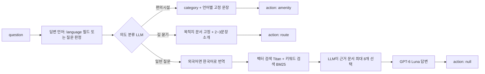
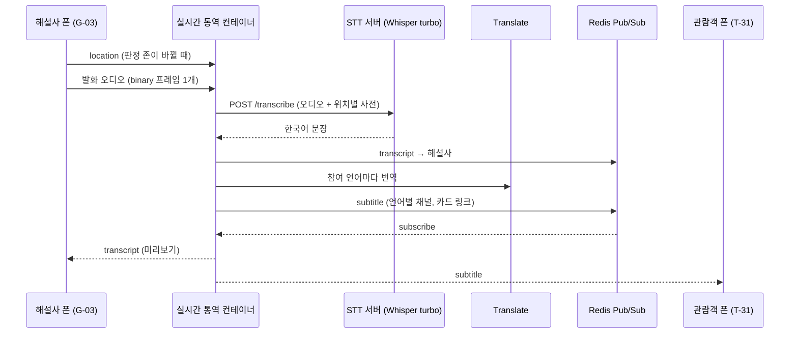

# GungGeum(宮今) API 명세서

- 버전: v0.2
- 작성일: 2026-10-26 (v0.1: 2026-10-21)
- 작성: Team APEX · 김병진 (BE)
- 기준: 기능 명세서 v0.3, 백엔드 `gunggeum-be` (FastAPI, 로컬 — 조직 리포 생성 전), 팀 저장소 gunggeum `deploy/` (커밋 `0c7d687`), STT 벤치마크 v2
- 관련 문서: ERD v0.2 · 서비스 아키텍처 v0.2 · deploy/API.md · 서버를 띄우면 `/api/docs` (Swagger)

화면과 서버 사이의 모든 인터페이스를 한 문서에 모았습니다. 서버 REST API, S3 정적 파일, 폰 JS 모듈, 라이브 투어 WebSocket을 다룹니다.

> **상태 표기**
>
> - **구현** = gunggeum-be에 구현되고 테스트됨 (테스트 55개). 질의응답·카드·코스는 팀 로직(`deploy/server`)을 그대로 감쌈
> - **[확인 필요]** = 팀 결정이 필요한 부분
> - **[변경]** = v0.1과 달라진 부분

## 0. 변경 이력

| 버전 | 날짜 | 내용 |
| --- | --- | --- |
| v0.1 | 2026-10-21 | 초안. 구현 3개(ask·card·course) + 초안 10개 |
| v0.2 | 2026-10-26 | **13개 모두 구현**(gunggeum-be). 확인 필요 A1~A8 중 A1·A2·A3·A4·A5·A8 정리. 해설사 소켓에 `location` 메시지 추가, 음성 형식 확정(STT 벤치마크 v2) |

---

## 1. 개요

### 1.1 구성

| 구분 | 담당 | 내용 |
| --- | --- | --- |
| API 서비스 | BE·AI | REST JSON API (`/api/*`). 질의응답, 카드, 코스, 세션, 일정, 공지, 집계 |
| 실시간 통역 | BE | WebSocket (`/ws/*`). 라이브 투어 자막 |
| STT 서버 **[추가]** | BE·AI | 집 장비(학기 중)에서 Whisper turbo. 실시간 통역 컨테이너만 호출 (앱이 직접 부르지 않음) |
| 정적 파일 | BE | S3 + CloudFront. 지도, POI, 판정 존, 사진 |
| 폰 모듈 | FE | `judge.mjs` (방문 판정), `route.mjs` (길찾기). 서버 호출 없음 |

### 1.2 공통 규칙

| 항목 | 규칙 |
| --- | --- |
| Base URL | `https://{host}/api` (CloudFront 같은 도메인). 개발: `http://localhost:8080/api` |
| 형식 | 요청·응답 모두 `application/json; charset=utf-8` |
| 인증 | 없음 (관광객 익명). 세션 생성은 가이드 접근 코드, 세션 종료·해설사 소켓은 가이드 토큰 |
| 언어 코드 **[변경]** | 요청·응답 모두 `ko` · `en` · `th` (서버가 팀 로직의 `한국어`·`English`·`ภาษาไทย`와 변환) |
| 문자 길이 **[변경]** | `question`·`request` 1~300자 (글자 수 기준). **넘으면 400** (팀 deploy/API.md는 "잘라서 씀" → 이 명세 기준으로 통일) |
| 시각 | ISO 8601, KST (`2026-10-21T14:00:00+09:00`) |
| CORS | 운영은 같은 도메인이라 끔. 개발은 `CORS_ORIGINS` 환경 변수의 출처만 허용 |

### 1.3 에러 형식

모든 에러는 같은 형식입니다. 앱은 문구를 그대로 보이지 말고 **상태 코드로 분기**합니다.

```json
{ "error": "<에러 설명 문구>" }
```

| 코드 | 의미 | 발생 조건 (구현) | 서버 문구 | 앱 처리 |
| --- | --- | --- | --- | --- |
| 400 | 잘못된 요청 | JSON 아님, 필수 필드 없음·빈 문자열, 300자 초과, 허용되지 않는 값(언어·event 등), `consent` false | `본문이 JSON 이 아닙니다` / `<필드> 값을 확인하세요` / `음성 미저장 동의(consent)가 필요합니다` | 입력 확인 문구 |
| 401 | 토큰 없음·틀림 | 세션 종료에 가이드 토큰 없음·틀림 | `가이드 토큰이 필요합니다` | 해설사 화면 재진입 |
| 403 | 접근 코드 틀림 | 세션 생성 시 `accessCode` 불일치 | `가이드 접근 코드가 올바르지 않습니다` | 코드 다시 입력 |
| 404 | 없음 | 없는 카드 id·세션 코드·경로 | `없는 카드` / `없는 세션` / `없는 경로` | "찾을 수 없음" 문구 |
| 429 | 요청 과다 | Nginx IP별 제한 (§1.4) | `요청이 너무 많습니다. 잠시 후 다시 시도하세요` | S-06 표시 후 재시도 안내 |
| 500 | 서버 오류 | LLM·DB 오류 (내부 메시지는 로그에만) | `답변을 만들지 못했습니다` | 일반 오류 문구 + 재시도 버튼 |
| 503 | 준비 중 | 서버 재시작·배포 중 | `서버를 준비 중입니다` | 잠시 후 재시도 |
| 504 | 시간 초과 | 60초 초과 (Nginx) | `답변이 너무 오래 걸립니다` | "시간이 오래 걸리고 있어요" + 재시도 |

### 1.4 요청 제한 (429) **[변경]** — 기능 명세서 17-5

| 경로 | 기준 | 순간 허용 |
| --- | --- | --- |
| `POST /api/ask`, `POST /api/course` | 관광객 IP당 분당 10회 | 5회 |
| `POST /api/sessions` | IP당 분당 5회 | 3회 |
| `POST /api/stats/visits` | IP당 분당 30회 | 10회 |

관광객 IP는 CloudFront가 붙이는 `CloudFront-Viewer-Address` 헤더로 구분합니다 (CloudFront 오리진 요청 정책에 이 헤더를 넣어야 함).

### 1.5 엔드포인트 한눈에 보기

| 메서드 | 경로 | 화면 | 상태 |
| --- | --- | --- | --- |
| POST | `/api/ask` | T-41, T-42, T-43, T-44 | 구현 |
| GET | `/api/card` | PNC | 구현 |
| POST | `/api/course` | T-14, T-15 | 구현 |
| GET | `/api/health` | 배포 확인 | 구현 |
| GET | `/api/notices` | T-10 배너, T-50 | 구현 |
| GET | `/api/tours/today` | T-30 | 구현 |
| POST | `/api/sessions` | G-01 | 구현 |
| GET | `/api/sessions/{code}` | T-31 진입, G-02 | 구현 |
| POST | `/api/sessions/{code}/end` | G-03 | 구현 |
| GET | `/api/sessions/{code}/summary` | T-32, G-04 | 구현 |
| POST | `/api/stats/visits` | T-51 (익명 집계) | 구현 |
| WS | `/ws/sessions/{code}/guide` | G-03 | 구현 |
| WS | `/ws/sessions/{code}/listen` | T-31 | 구현 |

---

## 2. 질의응답

### 2.1 `POST /api/ask` — 질문하기 (구현)

화면: T-41 Chat answer, T-42 No-evidence, T-43 Chat route, T-44 Nearby amenities · 소요 3~10초

질문 하나를 받아 답변과, 필요하면 폰이 할 일(`action`)을 돌려줍니다. 대화 기록은 없고 질문마다 독립입니다.

**요청**

| 필드 | 타입 | 필수 | 설명 |
| --- | --- | --- | --- |
| `question` | string | O | 1~300자, 한·영·태. 넘으면 400 |
| `language` | string | X | `ko` \| `en` \| `th`. **[변경] 구현됨**: 보내면 그 언어로 답하고, 없으면 질문 글자로 판정 (기능 명세서 17-11 제안안. 팀 승인 필요) |

```json
{ "question": "Why is Gyeonghoeru built on water?", "language": "en" }
```

**응답 200**

| 필드 | 타입 | 설명 |
| --- | --- | --- |
| `answer` | string | 답변 본문. 고유명사는 카드 링크 포함 (§2.2) |
| `language` | string | 답변 언어 `ko` \| `en` \| `th` **[변경]** 코드로 통일 |
| `action` | object \| null | 폰이 할 일. 일반 질문이면 `null` |
| `action.type` | string | `route` \| `amenity` |
| `action.to` | string | `type=route`일 때 목적지 POI id (`pois.json`의 `id`, 예 `place:gyotaejeon`) |
| `action.category` | string | `type=amenity`일 때 `restroom` \| `bench` \| `water` |

**예시: 일반 질문 (T-41)**

```json
{
  "answer": "[Gyeonghoeru (Banquet Pavilion)](card:b-173) stands on a man-made pond ...",
  "language": "en",
  "action": null
}
```

**예시: 근거 없음 (T-42)**

```json
{
  "answer": "The documents do not cover the number of roof tiles on Gyeonghoeru.",
  "language": "en",
  "action": null
}
```

**예시: 길 묻기 (T-43)**

```json
{
  "answer": "[Gyotaejeon (Queen’s Bedchamber)](card:b-164) was the queen's residence ...",
  "language": "en",
  "action": { "type": "route", "to": "place:gyotaejeon" }
}
```

**예시: 근처 편의시설 (T-44)**

```json
{
  "answer": "Showing the nearest restrooms on the map.",
  "language": "en",
  "action": { "type": "amenity", "category": "restroom" }
}
```

> 예시의 카드 id·이름은 실제 DB 값입니다 (경회루 b-173, 교태전 b-164, 근정전 b-160, 월대 t-24).

**서버 처리 순서** (팀 로직 `ask.reply` 확인)



- 편의시설은 의도 분류 1회만, 길 묻기는 의도 분류 + 소개 답변 2회 (검색·고르기 없이 목적지 문서 고정). 일반 질문은 최대 4회 (의도 · 번역 · 고르기 · 답변)

**답변 언어 판정 (`language`가 없을 때)**

1. "영어로", "in English", "태국어로", "in Thai" 같은 요청이 있으면 그 언어
2. 태국 문자가 있으면 `th`
3. 한글이 있으면 `ko`, 없으면 `en`

**규칙**

- 답변은 넣은 DB 문서(전각 문서 + 용어집)에 있는 사실만 씀
- 문서에 없으면 언어별 정해진 문장으로 답함. 일부만 있으면 그 부분만 답하고 빠진 부분을 한 문장으로 밝힘
- 길 묻기 `answer`는 2~3문장 소개만 쓰고 방향은 쓰지 않음. 목적지는 DB에 문서가 있는 전각만
- `action`이 있으면 앱은 `route.mjs`로 처리 (§5.2)

### 2.2 카드 링크 형식 **[확인됨]**

`answer` 안의 고유명사는 이름마다 처음 한 번만 링크로 표시합니다. 링크는 답변에 쓴 근거 문서의 이름에만 붙으므로 출처 역할을 합니다 (팀 로직 `cards.link_names`).

```
[표시 이름](card:<cardId>)
```

- `cardId`: `b-<serial>` (전각) 또는 `t-<no>` (용어)
- 앱은 `card:` 링크를 빨간 밑줄 고유명사로 렌더링하고, 탭하면 `GET /api/card?id=<cardId>`로 PNC를 엶. 일반 링크로 열지 않음
- 같은 표기를 라이브 자막(`subtitle.text`)과 코스 설명에서도 씀

---

## 3. 카드

### 3.1 `GET /api/card` — 고유명사 카드 (구현)

화면: PNC (T-12, T-15, T-31, T-41에서 호출)

**쿼리**

| 이름 | 타입 | 필수 | 설명 |
| --- | --- | --- | --- |
| `id` | string | O | `b-<serial>` 전각, `t-<no>` 용어 |

```
GET /api/card?id=b-160
```

**응답 200** **[변경]** `id`·`type` 포함 확인

| 필드 | 타입 | 설명 |
| --- | --- | --- |
| `id` | string | 요청한 카드 id |
| `type` | string | `building` \| `term` |
| `name` | string | 한글 이름 |
| `name_en` | string \| null | 영어 이름 `음역 (짧은 뜻)` |
| `name_th` | string \| null | 태국어 이름 `음역 (짧은 뜻)` |
| `text` | string | 한국어 설명. 전각은 문단을 합친 전체 설명 |
| `text_en` | string \| null | 영어 설명. 문단 하나라도 번역이 없으면 null |
| `text_th` | string \| null | 태국어 설명. 같은 규칙 |
| `category` | string \| null | 용어 분류. **전각 카드는 항상 null** |
| `photo` | string \| null | `/photos/<serial>.jpg` (CloudFront 기준). 라이선스가 있는 전각 사진만, 용어는 null |
| `photo_license` | string \| null | 사진 라이선스 |
| `photo_source` | string \| null | 사진 출처 |

```json
{
  "id": "b-160",
  "type": "building",
  "name": "근정전",
  "name_en": "Geunjeongjeon (Throne Hall)",
  "name_th": "คึนจองจอน (ท้องพระโรง)",
  "text": "…",
  "text_en": "…",
  "text_th": "…",
  "category": null,
  "photo": "/photos/160.jpg",
  "photo_license": "공공누리 제1유형",
  "photo_source": "…"
}
```

**앱 처리**

- 화면 언어에 맞는 `name_*`, `text_*`를 쓰고, null이면 한국어 `text`를 씀
- 사진을 보이면 `photo_license`, `photo_source`를 함께 표시
- 받은 카드는 기기에 캐시해 오프라인에서도 열 수 있게 함 **[제안]**
- 응답 헤더 `Cache-Control: public, max-age=86400` **[구현]** (카드 내용은 문서 배치로만 바뀜)

**에러:** 400 (`id` 없음), 404 (없는 id 또는 형식이 `b-숫자`·`t-숫자`가 아님)

---

## 4. 코스 추천

### 4.1 `POST /api/course` — 코스 만들기 (구현)

화면: T-14 Route input → T-15 Route result · 소요 10~20초

**요청**

| 필드 | 타입 | 필수 | 설명 |
| --- | --- | --- | --- |
| `request` | string | O | 1~300자 자유 문장. 예: "왕비 이야기 위주로 40분". 시간이 없으면 60분. 넘으면 400 |
| `language` | string | X | `ko` \| `en` \| `th`. `/api/ask`와 같은 규칙 **[변경] 구현됨** |

칩 UI를 유지하면 앱이 칩을 문장으로 바꿔 `request`에 넣습니다 (예: 60 min + Gardens → "정원 위주로 60분").

```json
{ "request": "a quiet 30-minute walk" }
```

**응답 200**

| 필드 | 타입 | 설명 |
| --- | --- | --- |
| `answer` | string | 코스를 이렇게 짠 이유 + 곳마다 볼 것. 카드 링크 포함, 시간·거리 숫자 없음 |
| `language` | string | `ko` \| `en` \| `th` |
| `course.minutes` | integer | 요청에서 읽은 가용 시간 (분) |
| `course.stops[]` | array | 들를 곳 (LLM이 정한 순서) |
| `course.stops[].id` | string | **[확인됨]** 전각 = `pois.json`의 `id` (예 `place:gyotaejeon`), 자연 지점 = `nature:<이름>` (`servermap/data/places.geojson`의 `name`) |
| `course.stops[].stayMin` | integer | 머무는 시간 (분) |

```json
{
  "answer": "This route keeps to the quieter western side ...",
  "language": "en",
  "course": {
    "minutes": 30,
    "stops": [
      { "id": "place:gyotaejeon", "stayMin": 8 },
      { "id": "nature:향원지", "stayMin": 3 }
    ]
  }
}
```

**서버 처리 (LLM 2회)**

1. 경로: 권역 해설 + 후보 간 걷기 시간표를 보고 들를 곳·순서·머무는 시간을 고름. 후보 목록 밖은 고르지 못함. 출발·도착은 광화문 기준
2. 설명: 고른 곳의 DB 문서로 `/api/ask`와 같은 규칙으로 설명

**앱 처리:** `Start navigation` 시 `fitCourse(내 위치, stops, minutes)`로 실제 걷기 시간을 다시 계산 (§5.2)

**에러:** 400, 429, 500, 504

---

## 5. 정적 파일과 폰 모듈

### 5.1 S3 정적 파일 (구현)

CloudFront로 배포하고 서비스 워커로 캐시해 오프라인에서 씁니다. PMTiles 때문에 CloudFront는 HTTP Range 요청을 허용합니다.

| 경로 | 내용 | 사용 화면 |
| --- | --- | --- |
| `servermap/style.json`, `servermap/tiles/palace.pmtiles` | MapLibre 스타일, 배경 타일 | T-10, T-16 |
| `servermap/data/paths.geojson` | 보행 길 (노드 id 배열) → 길 그래프 | T-16, T-43, T-44 |
| `servermap/data/pins.geojson` | 핀 (`category`: gate · hall · event · water · restroom · bench, `name:ko/en/th`) | T-10, T-44 |
| `servermap/data/places.geojson` | 자연 지점 등 장소 (코스의 `nature:<이름>`) | T-15, T-16 |
| `visit/data/pois.json` | POI 71곳: `id`(예 `place:gwanghwamun-gate`), name, category(gate · hall), pin, zoneIds, approachNodes, serial, group | T-11, T-13, T-16, T-51 |
| `visit/data/zones.geojson` | 판정 존(마당·띠·문) 도형 | T-13, T-51 |
| `photos/<serial>.jpg` | 전각 사진 (카드 id `b-<serial>`과 같은 번호) | PNC, T-11, T-12 |
| 해설 파일 | 전각별 해설 텍스트·오디오 (언어별). 경로 규칙 **[확인 필요]** | T-12 |

### 5.2 폰 JS 모듈 (구현)

서버를 호출하지 않고, 위치를 서버로 보내지 않습니다. 실제 인자·반환 형식은 `deploy/visit/*.mjs` 소스를 기준으로 합니다.

#### `route.mjs`

| 함수 | 입력 | 출력 | 화면 |
| --- | --- | --- | --- |
| `routeTo(from, to)` | 현재 위치, 목적지 POI id | 경로선, 거리(m), 걷기 시간(분) | T-12 Navigate here, T-43, T-16 |
| `nearestAmenities(from, category)` | 현재 위치, `restroom` \| `bench` \| `water` | 가까운 3곳 + 1등까지 경로 | T-44 |
| `fitCourse(from, stops, minutes)` | 현재 위치, `course.stops`, `course.minutes` | 실제 걷기 시간으로 맞춘 경유지, 뺀 곳 수 | T-16 |
| `nextStop(...)` | 현재 코스 상태, 스탬프 이벤트 | 다음 경유지 | T-16 |

- 길 그래프: `paths.geojson` → 노드·간선, 다익스트라 최단 경로

#### `judge.mjs`

| 항목 | 내용 |
| --- | --- |
| 입력 | Geolocation 위치 (좌표, 정확도, 시각) |
| 이벤트 `audio` | 판정 존 안에 7초 → T-13 토스트 |
| 이벤트 `stamp` | 판정 존 안에 25초 → T-51 스탬프, T-16 다음 경유지 |
| 필터 | 오차 25m 초과 위치 버림. 스탬프 체류는 오차 15m 이내만 셈. 점프(비정상 이동) 버림 |
| 저장 | `judge.saved()` → `{ visited: [poiId], lastAudio: { poiId: t } }`, localStorage에 저장해 다음 방문 때 복원 |

---

## 6. 운영

### 6.1 `GET /api/health` — 상태 확인 (구현)

로드밸런서·배포 확인용입니다. DB·LLM을 부르지 않습니다.

```json
{ "status": "ok", "version": "<배포 커밋 해시>" }
```

DB·LLM까지 확인하는 깊은 검사(`?deep=1`)는 만들지 않았습니다 **[확인 필요]**.

### 6.2 `GET /api/notices` — 공지 목록 (구현)

화면: T-10 공지 배너, T-50 Notices

**쿼리**

| 이름 | 값 | 설명 |
| --- | --- | --- |
| `lang` | `en` (기본) \| `th` \| `ko` | 이 언어 번역이 있으면 번역, 없으면 한국어 원문 (`lang: "ko"`로 표시) |
| `since` | ISO 시각 (선택) | 이 시각 이후 게시된 공지만 |

**응답 200** (최신순 최대 20건)

```json
{
  "notices": [
    {
      "id": "n-20261021-01",
      "type": "tour_cancelled",
      "title": "Today 14:00 English tour cancelled due to rain",
      "body": "…",
      "publishedAt": "2026-10-21T09:10:00+09:00",
      "lang": "en"
    }
  ]
}
```

- `type`: `tour_cancelled` \| `weather` \| `event_change`
- `id`: `n-<날짜>-<순번>`
- 배너에는 가장 최근 공지 1건을 표시
- **입력 [변경]:** 지금은 운영자가 명령으로 넣음 (`python -m app.cli notices add ... --translate`, Translate로 영·태 번역). 10분 간격 자동 수집은 수집 대상이 정해지면 추가 **[확인 필요]**

### 6.3 `POST /api/stats/visits` — 방문 익명 집계 (구현)

화면: T-51. 방문 기록 자체는 기기에만 있고, 서버에는 날짜·POI·언어·사건별 합계만 +1 합니다.

**요청**

| 필드 | 타입 | 설명 |
| --- | --- | --- |
| `poiId` | string | `pois.json`의 id (예 `place:geunjeongjeon-hall`). 영문·숫자·`:._-` 1~80자 |
| `event` | string | `audio` \| `stamp` |
| `lang` | string | `en` \| `th` \| `ko` |
| `date` | string | `YYYY-MM-DD`. 오늘 ±1일만 받음 |

```json
{ "poiId": "place:geunjeongjeon-hall", "event": "stamp", "lang": "en", "date": "2026-10-21" }
```

- 사용자 식별자, 좌표, 정확한 시각은 보내지 않음
- 운영기관 리포트용. 필요 여부 자체는 팀 결정 **[확인 필요]**

**응답:** 204 No Content

---

## 7. 라이브 투어 (구현)

**[변경]** v0.1 초안을 그대로 구현했습니다. 정해지지 않은 부분은 기능 명세서의 제안안으로 구현했습니다.

### 7.1 `GET /api/tours/today` — 오늘 해설 일정

화면: T-30

```json
{
  "date": "2026-10-21",
  "tours": [
    { "time": "10:00", "status": "ended", "sessionCode": null },
    { "time": "14:00", "status": "live", "sessionCode": "GB-1042" },
    { "time": "15:00", "status": "upcoming", "sessionCode": null }
  ]
}
```

- `status`: 연결된 세션이 `live`·`ended`면 그 상태, 아니면 시작 시각 + 해설 길이(기본 60분)가 지났으면 `ended`, 아니면 `upcoming`
- `sessionCode`: `live`일 때만 있음
- 일정 입력: 운영자 명령 (`python -m app.cli tours add 2026-10-27 10:00 11:00 ...`) **[확인 필요: 입력 주체]**

### 7.2 `POST /api/sessions` — 세션 만들기

화면: G-01

**요청**

| 필드 | 타입 | 필수 | 설명 |
| --- | --- | --- | --- |
| `title` | string | X | 투어 제목, 100자 이하 |
| `consent` | boolean | O | 음성 미저장 동의. `true`가 아니면 400 |
| `guideName` | string | X | T-31 헤더 표시용 (예: "Guide Kim"), 40자 이하 |
| `accessCode` | string | 조건부 | 서버에 `GUIDE_ACCESS_CODE`가 설정되어 있으면 필수, 다르면 403 (기능 명세서 17-1 제안안) |
| `tourTime` **[추가]** | string | X | `HH:MM`. 오늘 해설 일정(T-30)의 그 시각에 이 세션을 연결 |

**응답 201**

```json
{
  "code": "GB-1042",
  "joinUrl": "https://{host}/live/GB-1042",
  "guideToken": "…",
  "sourceLang": "ko",
  "startedAt": "2026-10-21T14:00:00+09:00"
}
```

- `code`: `GB-1000` ~ `GB-9999` 중 겹치지 않게 뽑음
- `joinUrl`을 G-02 QR에 담아 폰 기본 카메라로도 T-31에 바로 들어오게 함 (`PUBLIC_BASE_URL` + `/live/{code}`)
- `guideToken`: 해설사 WebSocket·종료 요청에 쓰는 토큰. **서버에는 해시만 저장**
- 처음 상태는 `waiting`. 해설사가 소켓에 붙으면 `live`

### 7.3 `GET /api/sessions/{code}` — 세션 정보

화면: T-31 진입 전 확인, G-02

```json
{
  "code": "GB-1042",
  "title": "Gyeongbokgung highlights",
  "guideName": "Guide Kim",
  "status": "live",
  "startedAt": "2026-10-21T14:00:00+09:00",
  "micOn": true
}
```

- `status`: `waiting` \| `live` \| `ended`. 없는 코드·형식이 다른 코드는 404

### 7.4 `POST /api/sessions/{code}/end` — 세션 종료

화면: G-03 `End session`. 헤더 `Authorization: Bearer <guideToken>` (없거나 틀리면 401).

- 종료 시 모든 관람객·해설사 소켓에 `session_ended`를 보내고, 진행 중 집계(최대 참여자·언어·언급 카드)를 DB로 옮긴 뒤 Redis 상태를 지움
- 이미 끝난 세션에 다시 보내도 같은 요약을 돌려줌

**응답 200:** §7.5와 같은 요약

### 7.5 `GET /api/sessions/{code}/summary` — 세션 요약

화면: T-32 (관람객), G-04 (가이드). 진행 중에도 호출 가능 (그 시점까지의 집계).

```json
{
  "code": "GB-1042",
  "durationSec": 3120,
  "peakParticipants": 23,
  "languages": { "en": 15, "th": 8 },
  "mentionedCards": ["b-160", "t-24"]
}
```

- `languages`: 언어별 최대 동시 참여자
- `mentionedCards`: 언급 횟수 많은 순
- 음성·자막 원문은 저장하지 않으므로 집계값과 카드 id만 돌려줌

### 7.6 WebSocket **[변경]**



#### `wss://{host}/ws/sessions/{code}/guide?token=<guideToken>` (G-03)

| 방향 | `type` | 내용 |
| --- | --- | --- |
| 해설사 → 서버 | (binary) | **발화 하나 = binary 프레임 하나.** VAD로 자른 발화 전체, WebM/Opus 권장 (WAV 16kHz 16bit도 됨), 2MB 이하. (STT를 Transcribe로 바꾼 경우만 PCM 16bit 16kHz 조각) |
| 해설사 → 서버 | `location` **[추가]** | `{ "type": "location", "poiId": "place:heungnyemun-gate" }` 판정 존에 들어갈 때마다. 이 위치의 사전으로 받아씀 (없으면 사전 없이 → 전각명 인식률 하락) |
| 해설사 → 서버 | `mic` | `{ "type": "mic", "on": false }` → 관람객에게 S-04 |
| 해설사 → 서버 | `ping` | 30초마다 → `pong` |
| 해설사 → 서버 | `text` (개발용) | `{ "type": "text", "textKo": "…" }` STT 없이 문장 직접 입력. 서버 설정 `ALLOW_TEXT_INPUT=1`일 때만 |
| 서버 → 해설사 | `presence` | `{ "type": "presence", "participants": 23, "languages": { "en": 15, "th": 8 } }` 접속·이탈 때마다 |
| 서버 → 해설사 | `transcript` | `{ "type": "transcript", "seq": 41, "textKo": "…" }` 인식 문장 미리보기 |
| 서버 → 해설사 | `mic` · `session_ended` · `pong` | 마이크 상태 확인, 종료 알림 |
| 서버 → 해설사 | `error` | `{ "type": "error", "message": "음성 인식 연결에 실패했습니다" }` STT 서버 모두 실패 시 (연속 실패는 한 번만) |

- 해설사 연결이 끊기면 서버가 마이크를 끈 것으로 처리 → 관람객에게 S-04

#### `wss://{host}/ws/sessions/{code}/listen?lang=en` (T-31)

| 방향 | `type` | 내용 |
| --- | --- | --- |
| 서버 → 관람객 | `mic` | 접속 직후 현재 마이크 상태, 이후 바뀔 때마다 → S-04 표시/해제 |
| 서버 → 관람객 | `subtitle` | 아래 예시 |
| 서버 → 관람객 | `gap` | `{ "type": "gap", "fromSeq": 38, "toSeq": 40 }` 재연결 중 놓친 구간 → 누락 표시 블록 |
| 서버 → 관람객 | `session_ended` | `{ "type": "session_ended" }` → T-32 이동 (이미 끝난 세션에 접속해도 바로 옴) |
| 관람객 → 서버 | `resume` | 재연결 시 `{ "type": "resume", "lastSeq": 37 }`. 놓친 게 있으면 `gap` |
| 양방향 | `ping` / `pong` | 30초 간격 (CloudFront·Nginx 유휴 끊김 방지) |

```json
{
  "type": "subtitle",
  "seq": 41,
  "timestamp": "2026-10-21T14:12:03+09:00",
  "textKo": "이곳은 근정전입니다. 월대 위에 서 보세요.",
  "text": "This is [Geunjeongjeon (Throne Hall)](card:b-160). Stand on the [Woldae (Elevated Stone Platform)](card:t-24).",
  "lang": "en",
  "cardIds": ["b-160", "t-24"]
}
```

- **놓친 자막은 다시 보내지 않고 `gap`만 보냅니다** (기능 명세서 17-3 제안안 구현). 자막 원문을 서버에 남기지 않기 위해서입니다
- 성능 목표: 해설사 발화 끝부터 `subtitle` 수신까지 3초 이내 (N4). 실측 2.03초 (Apple Silicon STT, 번역 제외)

#### 닫는 코드

| 코드 | 뜻 |
| --- | --- |
| 1000 | 세션 종료 |
| 4400 | 지원하지 않는 언어 (`lang`) |
| 4401 | 가이드 토큰 없음·틀림 |
| 4404 | 없는 세션 |
| 4410 | 이미 끝난 세션 (해설사) |

---

## 8. 화면 ↔ API 대응표

| 화면 | 호출 | 비고 |
| --- | --- | --- |
| T-10 Map home | S3 `servermap/`, `GET /api/notices` | 공지만 서버 호출 |
| T-11 Building list | S3 `visit/data/pois.json` |  |
| T-12 Building detail | CDN 해설 파일, `route.mjs routeTo` |  |
| T-13 Arrival toast | `judge.mjs` `audio` 이벤트 |  |
| T-14, T-15 | `POST /api/course` | 10~20초 로딩 |
| T-16 Navigation | `route.mjs fitCourse`, `nextStop`, `judge.mjs` `stamp` |  |
| T-30 Lobby | `GET /api/tours/today` |  |
| T-31 Live subtitles | `GET /api/sessions/{code}`, WS `listen` |  |
| T-32 Session ended | `GET /api/sessions/{code}/summary` |  |
| T-41 / T-42 | `POST /api/ask` (`action: null`) | 3~10초 로딩 |
| T-43 Chat route | `POST /api/ask` → `route.mjs routeTo` |  |
| T-44 Amenities | `POST /api/ask` → `route.mjs nearestAmenities` |  |
| T-50 Notices | `GET /api/notices` |  |
| T-51 Passport | `judge.saved()`, `POST /api/stats/visits` |  |
| G-01 | `POST /api/sessions` |  |
| G-02 | `GET /api/sessions/{code}` |  |
| G-03 | WS `guide`, `POST /api/sessions/{code}/end` |  |
| G-04 | `GET /api/sessions/{code}/summary` |  |
| PNC | `GET /api/card` | 하루 캐시 |
| S-06 | 모든 POST의 429 |  |

---

## 9. 확인 필요 목록

| # | 항목 | v0.2 상태 |
| --- | --- | --- |
| A1 | `language` 요청 필드 (`/api/ask`, `/api/course`) | **구현** (보내면 우선, 없으면 판정). 팀 승인만 남음 → 기능 명세서 17-11 |
| A2 | 카드 링크 문법 | **확정** `[이름](card:id)` |
| A3 | `/api/card` 응답의 `id`, 전각 카드 `category` | **확정** `id`·`type` 포함, 전각 `category`는 null |
| A4 | id 체계 통일 | **정리** 카드 id(`b-`/`t-`)와 POI id(`pois.json`의 `place:…`) 두 체계. `serial`로 서로 바꿈 (71곳 모두 serial 있음). 코스 자연 지점만 `nature:<이름>` |
| A5 | 에러 코드별 조건, 429 기준 | **확정** §1.3 · §1.4 |
| A6 | 정적 파일 경로·스키마, 해설 파일 경로 규칙 | 정적 파일은 확정 (§5.1). **해설 파일 경로 규칙은 남음** |
| A7 | `route.mjs`, `judge.mjs` 실제 인자·반환 | 소스 기준 (FE 연동 시 확정) |
| A8 | 라이브 투어 | **구현** 접근 제어 = `GUIDE_ACCESS_CODE`, 오디오 = 발화 1개 = 프레임 1개(WebM/Opus), 누락 자막 = `gap`만. 운영 접근 코드 값과 배포 방식은 남음 |
| A9 **[추가]** | 해설사 위치(`location`)와 STT 위치별 사전 | 사전 원본(해설 위치 26곳, 녹음 ID 키)을 `pois.json` id 키로 변환하는 담당·시점 |
| A10 **[추가]** | 깊은 상태 확인 (`/api/health?deep=1`) | 미구현 |
