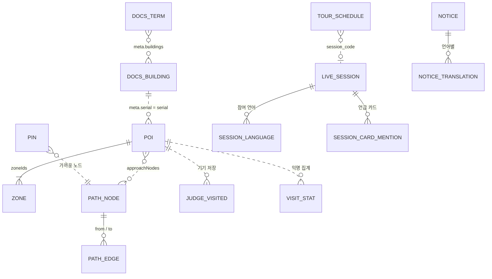
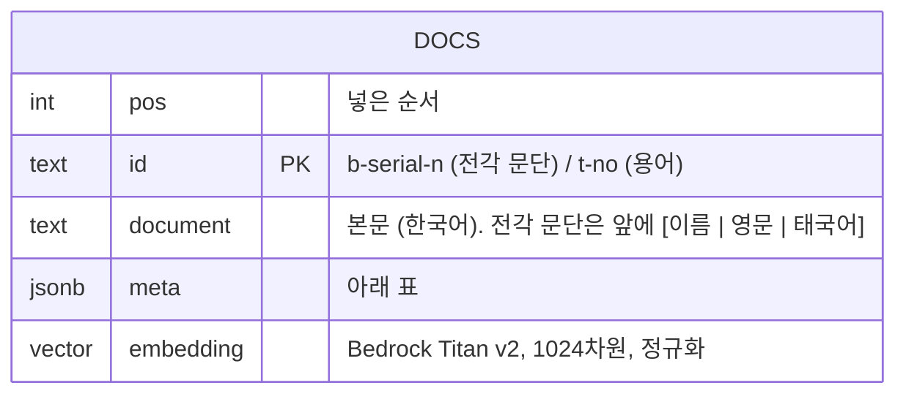
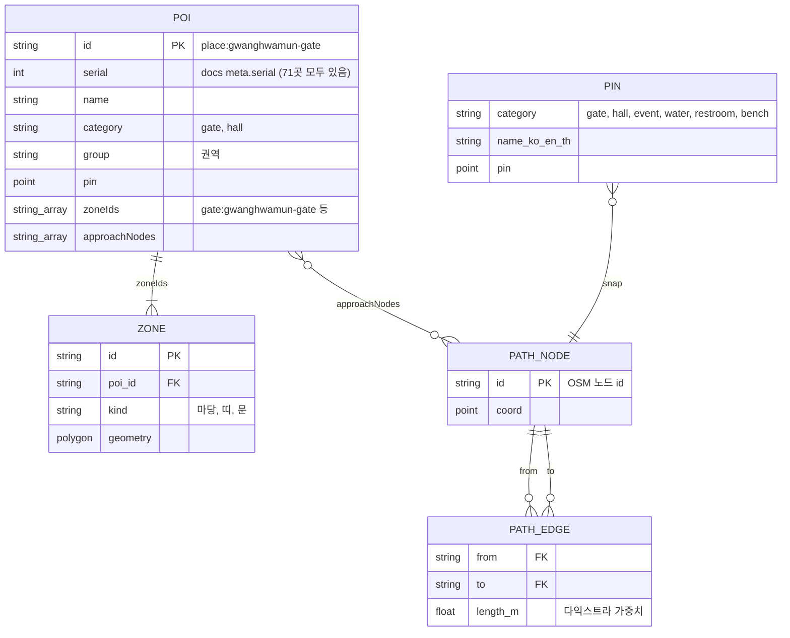
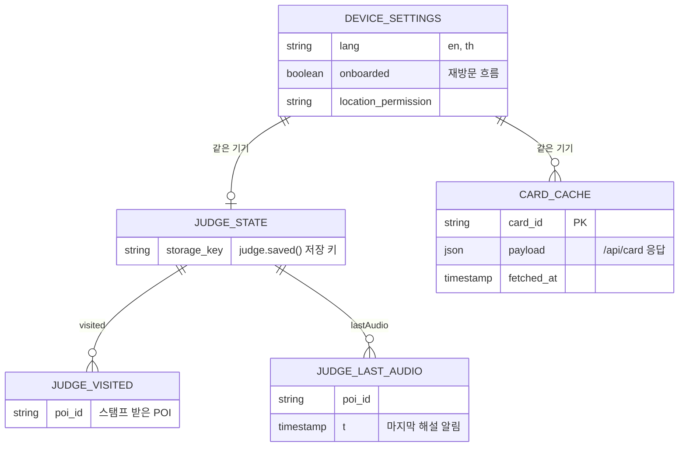
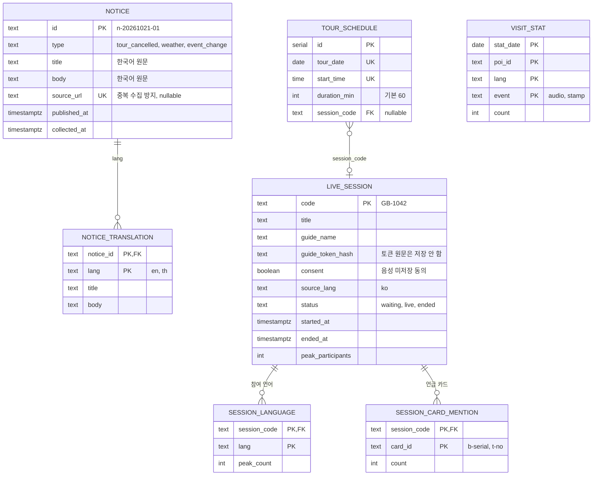

# GungGeum(宮今) ERD

- 버전: v0.2
- 작성일: 2026-10-26 (v0.1: 2026-10-21)
- 작성: Team APEX · 김병진 (BE)
- 기준: 기능 명세서 v0.3, API 명세서 v0.2, 백엔드 `gunggeum-be`, 팀 저장소 gunggeum `deploy/` (커밋 `0c7d687`)

宮今의 데이터는 네 곳에 나뉘어 있습니다. 서비스 원칙(무가입, 위치·음성 미저장)에 따라 **개인을 알 수 있는 데이터는 서버에 두지 않고** 기기에만 둡니다.

| 저장 위치 | 엔진 | 담는 것 | 상태 |
| --- | --- | --- | --- |
| ① 콘텐츠 DB | PostgreSQL + pgvector | 전각 문단 354 + 용어 231 = 문서 585개, Titan 임베딩 (질의응답·카드·코스 설명의 근거) | 구현 (`docs` 테이블 1개) |
| ② 정적 파일 | S3 + CloudFront | POI 71곳, 판정 존, 보행 길, 핀·편의시설, 사진 | 구현 |
| ③ 기기 저장소 | localStorage, Cache Storage | 언어 설정, 방문 판정 상태, 카드 캐시 | 구현 (판정 상태) |
| ④ 운영 DB + Redis | PostgreSQL, Redis | 라이브 세션, 해설 일정, 공지, 익명 집계 | **구현** (테이블 7개 + Redis 키) |

> **표기:** PK = 기본 키, FK = 외래 키, UK = 고유 키. 점선 관계(`..`)는 서로 다른 저장 위치 사이의 논리적 참조로, DB 제약은 걸지 않습니다.

## 0. 변경 이력

| 버전 | 날짜 | 내용 |
| --- | --- | --- |
| v0.1 | 2026-10-21 | 초안. ①은 `/api/card` 응답으로 역설계, ④는 설계 초안 |
| v0.2 | 2026-10-26 | ① **실제 DB 구조(`docs` 1테이블)로 교체**, v0.1의 3테이블은 정규화 제안으로 남김. ③ 정적 파일명 확정. ④ **구현된 스키마**로 교체 (notice id·tour_schedule 구조 변경, Redis 키 추가). 확인 필요 E1~E8 정리 |

---

## 1. 전체 관계도

---

## 2. 콘텐츠 DB (구현) **[변경]**

질의응답(`POST /api/ask`), 카드(`GET /api/card`), 코스 설명(`POST /api/course`)이 읽는 데이터입니다. 쓰기는 AI 담당의 문서 빌드 배치(`build_db.py` → `deploy/db/docs.sql.gz`)만 합니다. 빌드마다 테이블을 지우고 전부 새로 넣습니다 (Titan 비용 1회 약 3원).

### 2.1 실제 구조: `docs` 테이블 하나

v0.1에서 역설계한 `building` · `building_paragraph` · `term` 3테이블과 달리, **실제 DB는 문서마다 한 행이고 나머지는 JSON 메타데이터**입니다 (팀 로직 `deploy/server/pg.py`).

| 컬럼 | 타입 | 설명 |
| --- | --- | --- |
| pos | int | 넣은 순서. 카드 `text`는 이 순서로 문단을 합침 |
| id | text, PK | 전각 문단 `b-<serial>-<n>` (예 `b-151-0`), 용어 `t-<no>` |
| document | text | 한국어 본문 (국가유산청 설명문 기반) |
| meta | jsonb | 아래 표 |
| embedding | vector(1024) | 한국어 `document`의 Titan v2 임베딩. 인덱스 없음 (585건 전체 비교 0.01초 미만, 수만 건을 넘으면 HNSW) |

**`meta` 키**

| 키 | 전각 문단 | 용어 | 설명 |
| --- | --- | --- | --- |
| `type` | `building` | `term` | 카드 종류 |
| `serial` | O |  | 전각 번호 (151~227, 71곳). 카드 id `b-<serial>`, 사진 `photos/<serial>.jpg`, `pois.json`의 `serial`과 같음 |
| `no` |  | O | 용어 번호. 카드 id `t-<no>` |
| `name`, `name_en`, `name_th` | O | O | 이름. 영·태는 `음역 (짧은 뜻)` (예 `Geunjeongjeon (Throne Hall)`) |
| `text_en`, `text_th` | O | O | 영어·태국어 번역 (LLM 생성, 원어민 검수 전) |
| `nameId` | O |  | `pois.json`의 id (예 `place:gwanghwamun-gate`) |
| `group` | O |  | 권역 (코스 설계에서 묶음 단위) |
| `lat`, `lng` | O |  | 좌표 |
| `photo_license`, `photo_source` | O |  | 사진 라이선스·출처. 라이선스가 있을 때만 카드에 사진을 붙임 |
| `category` |  | O | 용어 분류 (예 `궁궐 공간·기능`). 전각 카드는 null |
| `buildings` |  | O | 이 용어가 나오는 전각 (예 `"159 근정전 조정, 160 근정전"`) — v0.1의 `term.building_serial` 역할 |
| `priority`, `references` |  | O | 용어 중요도(예 `핵심`), 참고 자료 |

**검색**

- 벡터: pgvector L2 거리 (`embedding <-> 질문 벡터`)
- 키워드: **PostgreSQL tsvector가 아니라 서버 메모리의 BM25** (한국어 2글자 조각, k1 1.5 · b 0.75). 한국어 형태소 설정이 필요 없음
- 검색은 한국어로만 함. 외국어 질문은 서버가 한국어로 옮긴 뒤 검색

**카드 만들기 (`GET /api/card`)**

- 전각: `meta.type = building AND meta.serial = <serial>`인 문단을 `pos` 순으로 합침. 문단 하나라도 번역이 없으면 `text_en`/`text_th`는 null
- 용어: `meta.type = term AND meta.no = <no>` 한 행

### 2.2 정규화 제안 (v0.1 구조, 미적용) **[확인 필요]**

v0.1의 `building` · `building_paragraph` · `term` 3테이블과 `v_card` 뷰는 **나중에 문서 관리 화면이 생기거나 문서가 수만 건이 될 때** 옮길 구조로 남깁니다. 지금은 AI 빌드 배치가 통째로 다시 만들고, 서버 코드(`pg.py`, `cards.py`)가 `docs` 구조를 쓰므로 바꾸지 않습니다. 옮길지는 AI 담당과 결정 → E1

| v0.1 제안 | 지금 `docs`에서 |
| --- | --- |
| `building.serial` · `name*` · `photo*` | 전각 문단 `meta`의 같은 키 (문단마다 반복) |
| `building_paragraph.text` · `text_en/th` · `embedding` | 전각 문단 행의 `document` · `meta.text_en/th` · `embedding` |
| `term.*` | 용어 행 |
| `term.building_serial` | `meta.buildings` (문자열, 여러 전각) |
| `search_ko tsvector` | 서버 메모리 BM25 |
| `v_card` 뷰 | 팀 로직 `cards.card()` |

---

## 3. 정적 파일 (구현) **[변경]**

S3에 파일로 있고 폰이 받아서 씁니다. DB 테이블은 아니지만 `judge.mjs`·`route.mjs`가 기대하는 구조라 같은 방식으로 정리합니다.

| 엔터티 | 파일 | 건수 | 비고 |
| --- | --- | --- | --- |
| POI | `visit/data/pois.json` | 71 | 판정·길찾기 대상. **모두 `serial`이 있어** 카드 id로 바꿀 수 있음 |
| ZONE | `visit/data/zones.geojson` | 48 (2주차 보고서) | 판정 존. 위요공간 13 · 측지 버퍼 17 · 출입문 원형 18 |
| PATH_NODE, PATH_EDGE | `servermap/data/paths.geojson` | — | 보행 길. `properties.nodes`(노드 id 배열)·`access`·`foot`. 폰이 노드·간선으로 바꿈 |
| PIN (편의시설 포함) | `servermap/data/pins.geojson` | — | `category`: gate · hall · event · water · restroom · bench, `name:ko/en/th` |
| 장소 | `servermap/data/places.geojson` | — | 자연 지점 등. 코스의 `nature:<이름>` |
| (개발용) 담장 | `visit/data/walls.geojson` | — | 시뮬레이터 표시용 |

**id 체계 [확정]**

| 쓰는 곳 | 형식 | 예 |
| --- | --- | --- |
| 카드 (`/api/card`, 답변·자막 링크) | `b-<serial>`, `t-<no>` | `b-160`, `t-24` |
| POI (`pois.json`, 길 묻기 `action.to`, 코스 전각, 방문 판정, 방문 집계, 해설사 `location`) | `pois.json`의 `id` | `place:gyotaejeon`, `place:geunjeongjeon-hall` |
| 코스 자연 지점 | `nature:<이름>` | `nature:향원지` |

POI의 `serial`과 콘텐츠 DB의 `meta.serial`로 POI id ↔ 카드 id를 바꿉니다. v0.1 걱정(문서가 없는 POI)은 없습니다: 71곳 모두 `serial`이 있습니다.

---

## 4. 기기 저장소 (구현 · 제안)

서버로 보내지 않는 데이터입니다. (v0.1과 같음)

| 키 | 저장소 | 형식 | 상태 |
| --- | --- | --- | --- |
| 판정 상태 | localStorage | `judge.saved()` → `{ "visited": [poiId], "lastAudio": { poiId: t } }` | 구현 |
| 언어·온보딩 | localStorage | `{ "lang": "en", "onboarded": true }` | 제안 |
| 카드 캐시 | Cache Storage 또는 IndexedDB | `/api/card` 응답 그대로 (서버도 하루 캐시 헤더를 줌) | 제안 |
| 정적 파일 | Cache Storage (서비스 워커) | 지도·POI·판정 존·길·사진 | 제안 |

- 방문 시각(`visitedAt`)은 지금 `visited` 배열에 없음. 여권(T-51)에 방문 날짜를 보일 거라면 필드 추가 필요 **[확인 필요]** → E5

---

## 5. 운영 DB + Redis (구현) **[변경]**

공지(T-50), 라이브 투어(T-30~T-32, G-01~G-04), 익명 집계를 위한 테이블입니다. 콘텐츠 DB와 같은 PostgreSQL 안에 있고, 서버가 처음 요청을 받을 때 자동으로 만듭니다 (`create table if not exists`). 음성·자막 원문과 개인 식별 정보는 저장하지 않습니다.

### 5.1 테이블 요약

| 테이블 | 화면 | 쓰는 쪽 | v0.1 대비 |
| --- | --- | --- | --- |
| notice | T-50, T-10 배너 | 운영자 명령 `app.cli notices add` (자동 수집은 수집 대상 결정 후) | **[변경]** id를 `n-날짜-순번` 문자열로, `original_ko` 대신 `title`·`body`(한국어 원문), `source` 컬럼 뺌 |
| notice_translation | T-50 | 같은 명령 (`--translate` = Amazon Translate, 또는 직접 입력) | 같음 |
| tour_schedule | T-30 | 운영자 명령 `app.cli tours add` | **[변경]** `id` PK + (날짜, 시각) UK, `duration_min` 추가. `status` 컬럼은 저장하지 않고 조회 때 계산 (연결된 세션 상태 → 시각) |
| live_session | G-01~G-04, T-31 | `POST /api/sessions`, 해설사 소켓 연결(→ live), 종료 API | 같음 |
| session_language | G-04 | 세션 종료 시 Redis 집계를 옮김 | 같음 (언어별 최대 동시 참여자) |
| session_card_mention | T-32 | 세션 종료 시 | 같음 (자막 원문 대신 카드 id만) |
| visit_stat | 운영 리포트 | `POST /api/stats/visits` | 같음 |

### 5.2 Redis (세션 진행 중에만 사용) **[변경]**

| 키 | 타입 | 내용 | 수명 |
| --- | --- | --- | --- |
| `session:{code}` | hash | status, micOn, startedAt, guideName, **location** (해설사 현재 위치 POI id → STT 위치별 사전) | 세션 종료 + 1시간 |
| `session:{code}:listeners` | hash | 연결 id → lang | 세션 종료 시 삭제 |
| `session:{code}:peak` **[추가]** | hash | 언어 → 최대 동시 인원, `_total` → 전체 최대 | 종료 시 DB로 옮기고 삭제 |
| `session:{code}:cards` **[추가]** | hash | 카드 id → 언급 횟수 | 종료 시 DB로 옮기고 삭제 |
| `session:{code}:seq` | string (INCR) | 자막 순번 | 세션 종료 시 삭제 |
| `session:{code}:sub:{lang}` | Pub/Sub 채널 | 언어별 자막 → 관람객 | — |
| `session:{code}:ctl` **[추가]** | Pub/Sub 채널 | 마이크 상태, 세션 종료 → 관람객·해설사 | — |
| `session:{code}:guide` **[추가]** | Pub/Sub 채널 | 참여 현황, 인식 문장 미리보기 → 해설사 | — |
| ~~`session:{code}:buffer:{lang}`~~ | — | **두지 않음.** 놓친 자막은 `gap`(순번)으로만 알림 (기능 명세서 17-3 제안안) | — |

- Redis는 디스크에 저장하지 않도록 띄웁니다 (`--save "" --appendonly no`). 자막 문장은 채널로 흘러가기만 합니다.

---

## 6. 개인정보·저장 원칙 점검 **[변경]**

| 데이터 | 저장 위치 | 서버 저장 | 근거 |
| --- | --- | --- | --- |
| 질문 원문 | — | DB에는 안 함. **단, 팀 로직이 코스 요청 문장과 검색 단계 결과를 서버 표준 출력(컨테이너 로그)에 남김** | E8 — 로그 보관 정책 필요 |
| 위치 좌표 | 기기 메모리 | 안 함 | `judge.mjs`·`route.mjs`가 폰에서 처리. 해설사 `location`은 좌표가 아니라 POI id |
| 방문 기록 | 기기 localStorage | 안 함 (날짜·POI·언어 합계만) | T-51 |
| 해설사 음성 | — | 안 함. STT 서버가 메모리에서 처리 후 버림 | G-01 동의 문구 |
| 자막 원문 | — (Pub/Sub로 흘러가기만) | 안 함 | T-32는 카드 id만 |
| 가이드 토큰 | DB | 해시만 | 세션 종료·해설사 소켓 인증 |
| 카메라 사진 | — | 안 함 | 온디바이스 추론 (T-20) |

---

## 7. 확인 필요 목록

| # | 항목 | v0.2 상태 |
| --- | --- | --- |
| E1 | 콘텐츠 DB 실제 구조, 임베딩 차원, 한국어 키워드 검색 | **확인** `docs` 1테이블 + jsonb meta, Titan v2 1024차원, 서버 메모리 BM25. 3테이블 정규화는 미적용 제안 (AI 담당과 결정) |
| E2 | 용어 ↔ 전각 연결 | **확인** 용어 `meta.buildings` (문자열, 여러 전각) |
| E3 | 카드 id, POI id, `place:` id 대응과 `serial` 없는 POI | **확정** POI id = `place:…`, `serial`로 카드 id와 연결, 71곳 모두 `serial` 있음 |
| E4 | 판정 존·보행 길·편의시설 파일 스키마 | 파일명 확정 (§3). 세부 속성은 `deploy/` 원본 기준 |
| E5 | 여권에 방문 날짜 표시 여부 (`visitedAt`) | 남음 |
| E6 | 해설 일정 입력 주체 | 지금은 운영자 명령. 운영기관 화면·자동 수집은 미정 |
| E7 | 자막 재전송 버퍼와 동의 문구 | **해소** 버퍼를 두지 않음 → "NOT stored"와 맞음 |
| E8 | 질문 로그 보관 여부·기간 | **남음.** 팀 로직이 코스 요청·검색 단계를 표준 출력에 찍으므로, 운영 전 끄거나(로그 수준) 보관 기간을 정해야 함 |
