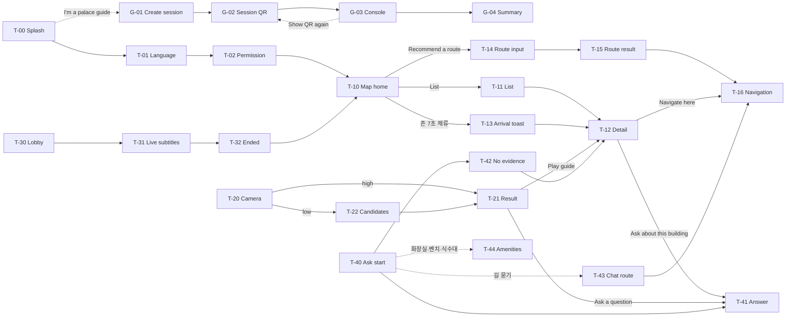

# GungGeum(宮今) 프로토타입 기능 명세서

- 버전: v0.3 (v0.2 + 백엔드 구현 · STT 벤치마크 v2 반영)
- 작성일: 2026-10-26 (v0.2: 2026-10-21)
- 작성: Team APEX (v0.1) · @박윤서 (deploy 반영분) · 김병진 (v0.3 BE 반영)
- 기준: Figma Make 스켈레톤 프롬프트 (4단계), 팀 저장소 gunggeum `deploy/` (커밋 `0c7d687`), 백엔드 `gunggeum-be`, STT 벤치마크 결과 보고서 v2
- 관련 문서: API 명세서 v0.2 · ERD v0.2 · 서비스 아키텍처 v0.2

경복궁을 찾는 외국인 개별 관광객용 모바일 웹앱(PWA)의 화면별 기능 명세입니다. 관광객은 QR로 바로 들어오고 회원가입이나 로그인이 없습니다. 각 화면에 제안서 요구사항(F·N 번호)과 처리 위치(기기 / API / WS)를 함께 적어, 프론트엔드와 백엔드가 같은 문서로 작업 범위를 나눌 수 있게 했습니다.

v0.3에서는 v0.2에서 "예정"이던 라이브 투어 · 공지 · 익명 집계 서버를 백엔드에 구현한 내용과, STT 벤치마크 v2로 정한 실시간 음성 인식 방식(Whisper turbo + 위치별 사전)을 반영했습니다. 팀 결정 항목 중 BE가 제안안으로 구현한 것은 **[구현·승인 필요]**로 표시했습니다.

> 표기 규칙: **[확인 필요]** = 팀 결정이 필요한 부분, **[제안]** = 작성자가 제안하는 동작, **[변경]** = 이전 버전과 달라진 부분, **[추가]** = 이전 버전에 없던 기능, **[구현·승인 필요]** = 제안안대로 서버에 구현됨, 팀 승인 필요

| 화면·상태 | MVP 대상 | 화면 그룹 | 지원 언어 |
| --- | --- | --- | --- |
| 33개 (컴포넌트 포함) | 12개 | 8개 | EN·TH 활성 (+ 한국어 콘텐츠) |

---

## 0. 변경 이력

| 버전 | 날짜 | 작성 | 내용 |
| --- | --- | --- | --- |
| v0.1 | 2026-10-06 | Team APEX | 초안. Figma Make 프롬프트 기준 화면 31개 정의 |
| v0.1 추가분 | 2026-10-20 | @박윤서 | deploy(`433a540`) 기준으로 언어, RAG, 길찾기, 코스, 방문 판정, PNC 수정 및 신규 기능 정리 |
| v0.2 | 2026-10-21 | Team APEX | 위 두 문서를 하나로 통합. 신규 기능에 화면 ID T-43, T-44 부여. 팀 결정 절 16 → 17 |
| v0.3 | 2026-10-26 | 김병진 | 서버 API 13개 구현(gunggeum-be) 반영: 라이브 투어 · 공지 · 집계가 "예정" → 구현. 실시간 STT를 Whisper turbo + 위치별 사전으로 (STT 벤치마크 v2). 해설사 위치 전송·오디오 형식 추가. 팀 결정 17-1·3·5·11 제안안 구현, 17-19~21 추가 |

### v0.2 → v0.3 변경 요약

| 항목 | v0.2 | v0.3 | 구분 |
| --- | --- | --- | --- |
| 서버 구현 | ask · card · course 로직만, 정식 서버 없음 | 13개 엔드포인트 모두 구현 (FastAPI, 테스트 55개) | [변경] |
| 답변 언어 (17-11) | 서버가 질문 글자로만 판정 | 앱이 `language`(`ko`·`en`·`th`)를 보내면 우선, 없으면 판정. 응답 `language`도 코드 | [구현·승인 필요] |
| 질문·코스 길이 | 1~300자 | 300자 초과는 400 (잘라 쓰지 않음) | [변경] |
| G-03 음성 인식 | Transcribe → 고유명사 교정 | 집 서버 Whisper large-v3-turbo + **해설사 위치별 받아쓰기 사전** (전각명 99.2%) | [변경] |
| 해설사 위치 | 없음 | 해설사 폰이 판정 존 진입 시 위치(POI id)를 서버로 보냄 → STT 사전 선택 | [추가] |
| 가이드 접근 제어 (17-1) | 없음 | 서버 설정의 가이드 접근 코드가 있으면 세션 생성 시 필요 | [구현·승인 필요] |
| 누락 자막 (17-3) | 미정 | 다시 보내지 않고 놓친 순번(`gap`)만 알림 | [구현·승인 필요] |
| 요청 제한 (17-5) | 기준 미정 | 질문·코스 IP당 분당 10회, 세션 생성 5회, 집계 30회 | [구현·승인 필요] |
| 해설 일정 · 공지 입력 | 미정 | 운영자 명령으로 입력 (자동 수집은 미구현) | [변경] |

---

## 1. 범위와 원칙

| 항목 | 내용 |
| --- | --- |
| 사용자 | ① 관광객 (외국인 개별 관광객, 익명) ② 궁 해설사 (한국어 해설, 가이드 모드) |
| 진입 | 관광객: QR 스캔 → T-00 / 해설사: T-00의 `I'm a palace guide` 링크 → G-01 |
| 계정 | 없음. 관광객은 익명, 해설 세션은 세션 코드(예: `GB-1042`)로 참여 (N1, N2). 해설사는 가이드 접근 코드로 세션을 만들고, 받은 가이드 토큰으로 마이크·종료를 제어 **[변경]** |
| 언어 | UI 문구는 영어. 해설·답변·카드는 한국어 · English · ภาษาไทย. 언어 선택에서 English·ไทย 활성 (N3) |
| 범위 밖 | 회원가입·로그인, 결제, 한복 대여 연동, 관리자(운영기관) 화면 |

### 설계 원칙

- **무가입·즉시 사용:** 첫 화면에 "No sign-up needed"를 명시하고 3단계(Splash → 언어 → 권한) 안에 지도에 도착합니다.
- **고유명사 일관성:** 해설·자막·답변에 나오는 전각·인물·유물 이름은 모두 같은 강조 스타일(빨간 밑줄)이고, 탭하면 같은 Proper Noun Card가 열립니다. (F9, N5)
- **이름 표기 통일:** 전각·용어 이름은 영어·태국어 모두 `음역 (짧은 뜻)` 형식 하나로 씁니다. 예: 근정전 = `Geunjeongjeon (Throne Hall)` / `คึนจองจอน (ท้องพระโรง)`. 답변, 지도 라벨, 카드, 라이브 자막이 같은 표기를 씁니다.
- **근거 기반 답변:** 질의응답과 코스 설명은 DB에 넣은 문서(국가유산청 설명문 기반 전각 문서 + 용어집)에 있는 사실만 씁니다.
- **오프라인 우선:** 지도, 오디오 가이드, 카메라 인식, 길찾기, 방문 판정은 네트워크 없이 동작합니다. 라이브 투어, 질의응답, 코스 추천만 연결이 필요합니다. (S-01)
- **위치 정보 기기 보관:** 방문 판정과 길찾기는 폰에서 처리하고 위치 좌표를 서버로 보내지 않습니다. 해설사 폰만 현재 해설 위치를 **좌표가 아닌 POI id**로 보냅니다 (음성 인식 사전 선택용). **[변경]**
- **음성·자막 미저장 [추가]:** 해설사 음성은 STT 서버가 메모리에서 처리하고 버립니다. 자막 문장도 서버에 남기지 않고, 세션이 끝나면 집계값과 언급된 카드 id만 남습니다.
- **긴 번역문 대응:** 모든 레이아웃은 flex/auto-layout으로, 태국어처럼 긴 문장에서도 깨지지 않아야 합니다.

---

## 2. 공통 UI

| 요소 | 구성 | 동작 | 노출 조건 |
| --- | --- | --- | --- |
| Top bar | 로고 "GungGeum", 언어 칩 `EN ▾`, 공지 벨, 여권(스탬프) 아이콘 | 언어 칩 → T-01 / 벨 → T-50 / 여권 → T-51 | 관광객 화면 전체 (T-00~T-02 제외) |
| Bottom tab bar | Map · Scan · Live Tour · Ask | 탭 → T-10 / T-20 / T-30 / T-40, 활성 탭은 빨간색 | 관광객 메인 화면, 가이드 모드에서는 숨김 |
| Mini audio player | 전각명, 재생/일시정지, 진행 바, 닫기 | 탭 전환 중에도 유지, 닫기 → 재생 중지 후 숨김 | 오디오 재생 중일 때 탭 바 위에 고정 |
| Screen ID tag | 좌상단 작은 회색 ID (예: `T-10`) | 없음 (리뷰용) | 프로토타입 전용, 실제 빌드에서 제거 |
| Screen Index | 좌하단 `☰ Screens` 버튼 → 그룹별 화면 목록, MVP 배지 | 항목 클릭 → 해당 화면으로 이동, 예외 상태(S-xx)도 여기서 켬 | 프로토타입 전용 |

### 시각 규칙

- 프레임 390×844, 회색조(#FFFFFF, #F2F2F2, #D9D9D9, #9E9E9E, #333) + 강조색 하나(#C8102E). 강조색은 주요 버튼, 활성 탭, 고유명사에만 씁니다.
- 이미지는 대각선 X가 그려진 회색 박스와 라벨(예: `[Photo: Geunjeongjeon]`), 아이콘은 선 아이콘입니다.
- 실제 사진을 쓸 때는 라이선스·출처(`photo_license`, `photo_source`)를 함께 표시합니다.

---

## 3. 화면 목록

처리 위치: **기기** = 폰·CDN에서 처리(서버 호출 없음) / **API** = API 서비스 컨테이너 / **WS** = 실시간 통역 컨테이너(WebSocket)

| ID | 화면 | 그룹 | MVP | 요구사항 | 처리 위치 | API·모듈 |
| --- | --- | --- | --- | --- | --- | --- |
| T-00 | Splash | 온보딩 |  | N1 N2 | 기기 |  |
| T-01 | Language select | 온보딩 |  | N3 | 기기 |  |
| T-02 | Permission guide | 온보딩 |  | F3 | 기기 |  |
| T-10 | Map home | 지도·오디오 | MVP | F1 F3 F6 | 기기, API | S3 `servermap/`, `GET /api/notices` |
| T-11 | Building list | 지도·오디오 | MVP | F3 | 기기 | S3 `visit/data/pois.json` |
| T-12 | Building detail | 지도·오디오 | MVP | F3 F4 F9 | 기기 | CDN 해설 파일 |
| T-13 | Arrival toast | 지도·오디오 |  | F3 | 기기 | `judge.mjs` |
| T-14 | Route input | 지도·오디오 |  | F2 | 기기 |  |
| T-15 | Route result | 지도·오디오 |  | F2 | API | `POST /api/course` |
| T-16 | Navigation | 지도·오디오 | MVP | F1 | 기기 | `route.mjs` |
| T-20 | Camera viewfinder | 스캔 |  | F10 | 기기 | 온디바이스 모델 |
| T-21 | Single result | 스캔 |  | F10 | 기기 |  |
| T-22 | Low-confidence result | 스캔 |  | F10 | 기기 |  |
| T-30 | Live Tour lobby | 라이브 투어 |  | F8 N2 | API | `GET /api/tours/today` |
| T-31 | Live subtitle view | 라이브 투어 | MVP | F8 F9 N4 N5 | WS | `GET /api/sessions/{code}`, WS `listen` |
| T-32 | Session ended | 라이브 투어 |  | F8 F9 | API | `GET /api/sessions/{code}/summary` |
| T-40 | Ask start | 질의응답 | MVP | F5 | 기기 |  |
| T-41 | Chat answer | 질의응답 | MVP | F5 F9 | API | `POST /api/ask` |
| T-42 | No-evidence answer | 질의응답 | MVP | F5 | API | `POST /api/ask` |
| T-43 | Chat route (길 묻기) | 질의응답 |  | F1 F5 | API, 기기 | `POST /api/ask` → `route.mjs` |
| T-44 | Nearby amenities | 질의응답 |  | F1 F5 | API, 기기 | `POST /api/ask` → `route.mjs` |
| T-50 | Notices | 부가 기능 |  | F6 | API | `GET /api/notices` |
| T-51 | Digital passport | 부가 기능 |  | F7 | 기기, API | `judge.mjs`, `POST /api/stats/visits` |
| G-01 | Create session | 가이드 모드 | MVP | F8 N2 | API | `POST /api/sessions` |
| G-02 | Session QR | 가이드 모드 | MVP | F8 N1 | API | `GET /api/sessions/{code}` |
| G-03 | Live session console | 가이드 모드 | MVP | F8 N4 | WS | WS `guide`, `POST /api/sessions/{code}/end` |
| G-04 | Session summary | 가이드 모드 |  | F8 | API | `GET /api/sessions/{code}/summary` |
| S-01 | Offline banner | 예외 상태 |  | — | 기기 |  |
| S-02 | Subtitle reconnecting | 예외 상태 |  | F8 | WS | WS `resume` → `gap` |
| S-03 | Weak GPS | 예외 상태 |  | F3 | 기기 | `judge.mjs` |
| S-04 | Guide mic off | 예외 상태 |  | F8 | WS | WS `mic` |
| S-05 | Camera permission denied | 예외 상태 |  | F10 | 기기 |  |
| S-06 | Too many requests | 예외 상태 |  | — | API | 429 |
| PNC | Proper Noun Card (bottom sheet) | 공통 컴포넌트 | MVP | F9 N5 | API (기기 캐시) | `GET /api/card` |

> **[변경]** v0.2의 "예정"(라이브 투어 · 공지 · 집계)은 모두 서버에 구현됐습니다 (gunggeum-be, 로컬 — 조직 리포 생성 전). 아직 없는 것은 **카메라 인식(T-20~T-22)** 과 **프론트엔드 연동**입니다.

---

## 4. 화면 흐름

주요 이동만 표시했습니다. 탭 바와 Top bar 아이콘으로는 어느 메인 화면에서든 이동할 수 있습니다.

---

## 5. 온보딩

### T-00 Splash

`N1 N2` · 처리 위치: 기기

QR로 들어온 관광객에게 서비스 정체성과 "가입 없음"을 바로 알립니다.

- **진입:** QR 스캔으로 연 URL, 앱 첫 실행
- **구성:** 로고, 태그라인 "Your palace guide in your language", "No sign-up needed", `Start` 버튼, 작은 링크 `I'm a palace guide`
- **동작:**
    - `Start` → T-01
    - `I'm a palace guide` → G-01 (가이드 모드, 탭 바 없음)
- **비고:** 재방문 시(언어·권한 설정 완료) 바로 T-10으로 보낼지 **[확인 필요]** → 17-9

### T-01 Language select

`N3` · 처리 위치: 기기

이후 모든 해설·답변·카드·공지·자막의 언어를 정합니다.

- **진입:** T-00 Start, Top bar 언어 칩
- **구성:** 언어 목록: English (활성), ไทย (활성). Tiếng Việt · Bahasa Indonesia는 목록에서 뺄지 "Coming soon"으로 둘지 **[확인 필요]** → 17-12
- **동작:**
    - 언어 선택 → T-02 (온보딩 중) 또는 이전 화면 복귀 (언어 칩으로 진입 시)
    - 비활성 언어는 탭되지 않음
- **데이터:** 선택 언어(`en` · `th`)를 기기에 저장
- **서버와의 관계 [변경] [구현·승인 필요]:** 앱은 질문·코스 요청에 `language`를 함께 보내고, 서버는 그 언어로 답합니다. 보내지 않으면 지금처럼 질문 글자로 판정합니다 (§9). 라이브 자막(`listen?lang=`)과 공지(`?lang=`)도 같은 코드를 씁니다. → 17-11
- **콘텐츠:** 영어·태국어 이름과 카드 설명은 LLM 생성 번역이라 원어민 검수가 남아 있습니다. → 17-14

### T-02 Permission guide

`F3` · 처리 위치: 기기

위치 권한을 왜 쓰는지 먼저 설명한 뒤 브라우저 권한 요청을 띄웁니다.

- **구성:** 설명 "location is used for auto-playing audio guide", `Allow location`, `Not now`
- **동작:**
    - `Allow location` → 브라우저 위치 권한 요청 → T-10
    - `Not now` → T-10 (현재 위치 점 없음, 도착 알림 꺼짐)
- **예외:** 권한 거부 시 T-10에서 위치 기능 없이 사용, 목록(T-11)으로 해설 선택
- **비고:** 위치는 폰 안에서만 쓰고 서버로 보내지 않는다는 문구 추가 **[제안]**. "auto-playing" 문구 → 17-2

---

## 6. 지도·오디오 가이드

### T-10 Map home (MVP)

`F1 F3 F6` · 처리 위치: 기기, API

궁 안 위치와 전각을 보여 주는 관광객 메인 화면입니다.

- **진입:** 온보딩 완료, Map 탭, T-32 `Back to map`
- **구성:**
    - 회색 지도 플레이스홀더 + 전각 핀 12개 (절대 위치)
    - 파란 "you are here" 점
    - 상단 공지 배너 "Today 14:00 English tour cancelled due to rain"
    - 플로팅 `Recommend a route`, `List` 토글, `Simulate arrival` (프로토타입 전용)
- **동작:**
    - 핀 탭 → T-12 **[확인 필요]** → 17-4
    - `List` → T-11
    - `Recommend a route` → T-14
    - 공지 배너 탭 → T-50
    - `Simulate arrival` → T-13 토스트
- **예외:** S-01 오프라인 배너, S-03 GPS 약함
- **실제 구현:** MapLibre GL + S3 정적 파일 `servermap/` (지도 스타일·타일·길·핀·라벨), Geolocation API. 지도 라벨은 §1의 이름 표기 규칙을 따름. 공지 배너는 `GET /api/notices?lang=` 의 최신 1건 **[변경]**

### T-11 Building list (MVP)

`F3` · 처리 위치: 기기

지도 대신 목록에서 전각을 찾고 해설을 고릅니다. GPS가 안 될 때의 대체 경로이기도 합니다.

- **진입:** T-10 List, S-03 / S-05의 대체 버튼
- **구성:** 검색창, 전각 카드 (썸네일 박스, 이름, 분류, 거리, 오디오 길이)
- **동작:**
    - 검색어 입력 → 이름(한·영·태) 기준 실시간 필터
    - 카드 탭 → T-12
- **상태:** 검색 결과 없음 문구 **[확인 필요]** → 17-8. 위치 권한이 없으면 거리 표시 숨김
- **데이터:** POI 목록 (`visit/data/pois.json`, CDN 캐시). 목록에 판정 대상 71곳을 모두 보일지, 주요 전각만 보일지 **[확인 필요]** → 17-16

### T-12 Building detail (MVP)

`F3 F4 F9` · 처리 위치: 기기

한 전각의 현지화 해설(텍스트·오디오)을 제공하고, 길찾기와 질문으로 이어 줍니다.

- **진입:** T-10 핀, T-11 카드, T-13 토스트, T-21 Play guide, PNC Open building guide, T-42 관련 카드
- **구성:** 대표 사진 박스 (라이선스·출처 표시), 이름 (`음역 (짧은 뜻)`) + 한글명, `Play audio guide`, 현지화 설명문, `Navigate here`, `Ask about this building`
- **동작:**
    - `Play audio guide` → 재생 시작, Mini player 표시
    - 설명문 속 고유명사(King Sejong, Irworobongdo, Eojwa throne) 탭 → PNC
    - `Navigate here` → T-16 (목적지 = 이 전각, `routeTo`)
    - `Ask about this building` → T-41 (전각명 프리필). 대화 기록이 없으므로 프리필 문장에 전각명을 꼭 넣음 **[제안]**
- **실제 구현:** 설명문·오디오는 미리 생성한 파일(LLM 원고 → 검수 → TTS 배치 합성)을 CDN에서 받음. 재생은 서버 호출 없음. 해설 파일 경로 규칙은 **[확인 필요]** (API 명세서 A6)

### T-13 Arrival toast

`F3` · 처리 위치: 기기 (`judge.mjs`)

관광객이 전각에 도착하면 해설 재생을 제안합니다.

- **구성:** T-10 위 토스트 "You've arrived at Geunjeongjeon ▶ Play guide"
- **동작:**
    - 토스트의 Play guide 탭 → 해설 재생 (T-12로 이동할지, 지도에 머물며 Mini player로 재생할지 **[확인 필요]**)
    - 일정 시간 뒤 자동 사라짐 (시간 **[확인 필요]**)
- **프로토타입:** T-10의 `Simulate arrival` 버튼으로 발생
- **실제 구현 (방문 판정):**
    - 판정 대상 71곳, 판정 존 48개(마당·띠·문) 기준
    - 존 안에 **7초** 머물면 `audio` 이벤트 → 이 토스트 표시
    - 존 안에 **25초** 머물면 `stamp` 이벤트 → T-51 스탬프 기록
    - GPS 오차가 25m보다 큰 위치는 버림. 스탬프 체류 시간은 오차 15m 이내 위치만 셈. 너무 빠른 이동(점프)도 버림
    - 같은 곳의 해설 알림은 마지막 알림 시각(`lastAudio`)으로 중복 방지
    - 위치는 서버로 보내지 않음

### T-14 Route recommendation input

`F2` · 처리 위치: 기기

가용 시간과 관심사를 받아 맞춤 동선을 만듭니다.

- **구성:**
    - 자유 문장 입력창 (예: "왕비 이야기 위주로 40분", "a quiet 30-minute walk")
    - 가용 시간 칩 (30 / 60 / 90+ min), 관심사 칩 (Architecture, Royal life, Gardens, History) 유지 여부 **[확인 필요]** → 17-18
    - `Create route`
- **동작:**
    - `Create route` → T-15
    - 칩을 유지하면 앱이 칩을 문장으로 바꿔 보냄 (예: 60 min + Gardens → "정원 위주로 60분") **[제안]**
- **검증 [변경]:** 요청 문장 1~300자. **300자를 넘으면 서버가 400** (앱에서 미리 막음). 시간이 없으면 서버가 60분으로 가정

### T-15 Recommended route result

`F2` · 처리 위치: API (`POST /api/course`) · 소요 10~20초

추천 경유지와 설명을 보여 줍니다.

- **구성:** 로딩 표시 (필수), 말풍선 `answer` (코스를 이렇게 짠 이유 + 곳마다 볼 것, 카드 링크 포함), 지도에 경유지 번호 핀, `Start navigation`
- **동작:**
    - 답변 속 카드 링크 탭 → PNC
    - `Start navigation` → T-16
    - 경유지 핀 탭 → T-12 **[제안]**
- **서버 처리 (LLM 2회):**
    1. 경로: 권역 해설 + 후보 간 걷기 시간표를 보고 들를 곳·순서·머무는 시간을 고름. 후보 목록 밖은 고르지 못함. 출발·도착은 광화문 기준
    2. 설명: 고른 곳의 DB 문서로 챗봇과 같은 규칙으로 설명
- **비고:** `answer`에는 시간·거리 숫자가 없음. 실제 걷기 시간은 폰이 T-16에서 계산. 경유지 id는 전각 = `pois.json` id(예 `place:gyotaejeon`), 자연 지점 = `nature:<이름>` **[변경]**
- **에러:** 429 → S-06

### T-16 Navigation in progress (MVP)

`F1` · 처리 위치: 기기 (`route.mjs`)

궁 안 도보 길안내입니다.

- **진입:** T-15 Start navigation, T-12 Navigate here, T-43 길 묻기, T-44 편의시설
- **구성:** 경로선이 그려진 지도, 상단 안내 카드 "Walk 120m to Sajeongjeon", 다음 경유지, `End`
- **동작:**
    - 코스 시작 시 `fitCourse(내 위치, stops, minutes)`로 실제 걷기 시간을 다시 계산. 시간을 넘치는 곳은 빼고 "n곳 뺌" 표시
    - 다음 곳까지 경로선 표시. 방문 판정의 스탬프가 다음 곳이면 `nextStop`으로 다음 곳으로 넘어감
    - 마지막 곳 뒤에는 출발점으로 돌아오는 길 표시
    - 경유지 도착 → T-13 토스트
    - `End` → T-10
- **실제 구현:** 편집기에서 만든 `paths.geojson`을 그래프로 만들어 다익스트라 최단 경로 계산. 서버 호출 없음

---

## 7. 스캔 (카메라 전각 인식)

> 미구현 (모델 평가 중). v0.1 내용 유지.

### T-20 Camera viewfinder

`F10` · 처리 위치: 기기

카메라로 비춘 전각이 무엇인지 알려 줍니다.

- **구성:** 어두운 카메라 화면 플레이스홀더, 프레이밍 가이드 사각형, 힌트 "Point your camera at a building", 나침반 방향 표시, 셔터 버튼, 신뢰도 토글 (프로토타입 전용)
- **동작:**
    - 셔터 (토글 High) → T-21
    - 셔터 (토글 Low) → T-22
- **예외:** S-05 카메라 권한 거부
- **실제 구현:** EfficientNet-B0 양자화 모델(10MB 이하)을 기기에서 추론 (TF.js / ONNX Runtime Web). 현재 위치 + 나침반 방향(DeviceOrientation)으로 후보를 좁힘. 사진은 서버로 보내지 않음

### T-21 Single result

`F10` · 처리 위치: 기기

- **구성:** 뷰파인더 위로 올라오는 하단 카드: 사진 박스, "This is Geunjeongjeon", 신뢰도 라벨 "High match", `Play guide`, `Ask a question`
- **동작:**
    - `Play guide` → T-12
    - `Ask a question` → T-41 (전각명 프리필)
    - 카드 닫기 → T-20 **[제안]**

### T-22 Low-confidence result

`F10` · 처리 위치: 기기

확신이 낮을 때 틀린 답을 단정하지 않고 사용자에게 고르게 합니다.

- **구성:** "Which one are you looking at?" + 후보 카드 3개 (Geunjeongjeon / Sajeongjeon / Heungnyemun)
- **동작:** 후보 선택 → 해당 전각의 T-21 또는 바로 T-12 **[확인 필요]**
- **실제 구현:** 1순위 확률이 기준값 미만이면 상위 3개를 보여 줌. 기준값은 평가셋으로 정함

---

## 8. 라이브 투어 (실시간 통역 자막)

> **[변경]** 서버 구현 완료 (REST 5개 + WebSocket 2개). 프론트엔드 연동 전.

### T-30 Live Tour lobby

`F8 N2` · 처리 위치: API (`GET /api/tours/today`)

궁의 한국어 정기 해설에 자국어 자막으로 참여하는 입구입니다.

- **구성:** 설명 "Join the palace's Korean guided tour with live subtitles in your language", 오늘 일정 (예: 10:00, 11:00, 13:00, 14:00, 15:00, 16:00 / Upcoming · Live now · Ended), `Scan session QR`, `Join demo session`
- **동작:**
    - `Scan session QR` → QR 스캐너 → T-31
    - `Join demo session` → T-31
    - "Live now" 일정 탭 → 그 일정의 `sessionCode`로 T-31 **[제안]** (live일 때만 서버가 코드를 줌)
- **실제 구현 [변경]:**
    - 일정은 운영자가 명령으로 입력 (`app.cli tours add <날짜> 10:00 11:00 …`). 운영기관 화면·자동 수집은 **[확인 필요]** (ERD E6)
    - 상태: 연결된 세션이 live·ended면 그 상태, 아니면 시작 + 해설 길이(기본 60분)가 지나면 Ended, 아니면 Upcoming
    - 해설사가 세션을 만들 때 시각(`tourTime`)을 주면 그 일정에 연결됨
- **예외:** S-01 오프라인이면 탭 자체가 비활성

### T-31 Live subtitle view (MVP)

`F8 F9 N4 N5` · 처리 위치: WS (`listen?lang=en|th|ko`)

해설사의 한국어 설명을 실시간 번역 자막으로 보여 주는 핵심 화면입니다.

- **헤더:** 빨간 점 "LIVE", 가이드 이름 "Guide Kim", 경과 시간, 연결 상태 배지 (Connected / Reconnecting / Offline)
- **자막:**
    - 해설사가 한 문장을 끝낼 때마다 새 자막 블록 추가, 자동 스크롤 **[변경]** (발화 단위 인식이라 말하는 도중에는 나오지 않음)
    - 블록 = 선택 언어 번역 + (토글 시) 작은 회색 한국어 원문 (`textKo`)
    - 고유명사 강조 (`[이름](card:id)`), 탭 → PNC
    - 누락 표시 "⚠ Some subtitles were missed while reconnecting" — 재연결 후 서버의 `gap` 메시지로 표시
- **하단 제어:** 글자 크기 `A-` `A+`, `Show original Korean` 토글, `Leave`
- **동작:**
    - `Leave` → T-30 또는 T-10 **[확인 필요]** (이탈 확인 단계 여부도 결정) → 17-10
    - 해설사가 세션 종료 → `session_ended` → T-32 자동 이동
    - 사용자가 위로 스크롤하면 자동 스크롤 멈춤, "새 자막" 버튼 표시 **[제안]**
    - 30초마다 `ping` (연결 유지), 재연결 시 마지막 순번으로 `resume`
- **예외:** S-02 재연결 중, S-04 해설사 마이크 꺼짐
- **성능 목표:** 해설사 발화부터 자막 표시까지 3초 이내 (N4). 실측: 실제 한국어 음성 4.5초 → 자막 2.03초 (Apple Silicon STT, 번역 제외)

### T-32 Session ended

`F8 F9` · 처리 위치: API (`GET /api/sessions/{code}/summary`)

- **구성:** "The tour has ended", 해설 중 언급된 전각 칩 목록, `Back to map`
- **동작:**
    - 전각 칩 → T-12 (또는 PNC)
    - `Back to map` → T-10
- **데이터:** `mentionedCards` (언급 많은 순 카드 id). 서버에 자막 원문은 저장하지 않으므로 카드 id만 집계

---

## 9. 질의응답 (T-40 ~ T-44)

### 답변 언어 결정 [변경] [구현·승인 필요]

1. 앱이 `language`(`ko` · `en` · `th`)를 보내면 그 언어
2. 보내지 않으면 서버(`ask.answer_language`)가 질문으로 판정
    - "영어로", "in English", "태국어로", "in Thai" 같은 요청이 있으면 그 언어
    - 질문에 태국 문자가 있으면 태국어
    - 한글이 있으면 한국어, 없으면 영어
3. 응답의 `language`도 `ko` · `en` · `th` 코드

`/api/ask`, `/api/course` 모두 같은 규칙입니다. → 17-11

### T-40 Ask start (MVP)

`F5` · 처리 위치: 기기

- **구성:** 안내 "Ask anything about Gyeongbokgung in your language. Answers are based on official Korea Heritage Service materials.", 추천 질문 칩 3개, 입력창
- **동작:**
    - 추천 칩 탭 → 해당 질문 전송 → T-41
    - 직접 입력 (1~300자, 넘으면 전송 막음) → T-41 / T-42 / T-43 / T-44 (서버 의도 분류 결과에 따름)
- **추천 질문:** "Why is Gyeonghoeru built on water?" / "Where did the king sleep?" / "What is the painting behind the throne?"
- **비고:** 길 묻기·화장실 찾기도 여기서 할 수 있다는 예시 칩 추가 (예: "Where is the nearest toilet?") **[제안]**

### T-41 Chat answer (MVP)

`F5 F9` · 처리 위치: API (`POST /api/ask`) · 소요 3~10초

- **진입:** T-40, T-12 Ask about this building, T-21 Ask a question (프리필)
- **구성:** 사용자 말풍선, 로딩 표시 (필수), 봇 답변 (고유명사 = 카드 링크), 입력창 + 전송 버튼
- **동작:**
    - 카드 링크 탭 → PNC
    - 추가 질문 전송 → 답변 누적 (화면에만 누적, 서버는 질문마다 독립)
- **서버 처리:**
    1. 의도 분류 (LLM): 일반 질문 / 길 묻기 (T-43) / 근처 편의시설 (T-44)
    2. 일반 질문: 외국어면 한국어로 옮겨 검색 → 벡터 검색 + 키워드 검색 → LLM이 근거 문서 최대 8개 선택 → GPT-6 Luna가 답변 (임베딩은 Bedrock Titan)
    3. 답변은 넣은 DB 문서에 있는 사실만 씀 (국가유산청 설명문 기반 전각 문서 + 용어집)
- **고유명사 링크:** 답변 속 전각·용어 이름은 처음 한 번만 카드 링크로 표시. 링크는 답변에 쓴 근거 문서에만 붙으므로 링크가 출처 역할을 함
- **Sources 칩:** v0.1의 Sources 칩 대신 카드 링크가 근거를 보여 줌. Sources 칩을 따로 둘지 **[확인 필요]** → 17-13
- **제약:** 대화 기록 없음. "거기는?" 같은 후속 질문은 알아듣지 못함 → 17-15
- **비용·시간 (2주차 평가):** 질문당 평균 4.3초(한국어)~5.9초(영어), 약 1.4원
- **에러:** 400 (빈 질문·300자 초과), 429 → S-06, 500·504 → 일반 오류 + 재시도

### T-42 No-evidence answer (MVP)

`F5` · 처리 위치: API (`POST /api/ask`)

공식 자료에 근거가 없으면 추측하지 않는다는 원칙을 화면으로 보여 줍니다.

- **구성:** 언어별 정해진 문장의 봇 답변 (예: "The documents do not cover ...", "เอกสารไม่มีข้อมูลเกี่ยวกับ ...") + 관련 전각 가이드 카드
- **부분 근거:** 질문 일부만 문서에 있으면 그 부분만 답하고 빠진 부분을 한 문장으로 밝힘
- **동작:** 카드 탭 → T-12
- **프로토타입:** 추천 질문 3개 외 모든 입력은 T-42로 응답
- **실제 구현:** LLM이 넣은 문서에 없다고 판단하면 정해진 문장을 반환
- **비고:** 응답에는 "관련 전각"을 알려 주는 필드가 없음. 관련 전각 카드를 유지할지 **[확인 필요]** → 17-17

### T-43 Chat route (길 묻기)

`F1 F5` · 처리 위치: API (`POST /api/ask`) → 기기 (`route.mjs`)

채팅에서 목적지를 물으면 짧은 소개와 함께 지도에 길을 그립니다.

- **예:** "교태전 어떻게 가?", "Where is Gyeonghoeru?", "ไปเคียวแทจอนยังไง"
- **응답:** `answer` = 목적지 짧은 소개 2~3문장 (무엇인지, 가서 볼 것. 방향은 쓰지 않음) + `action: {type: "route", to: "place:gyotaejeon"}` (`to` = `pois.json` id)
- **폰 동작:** `routeTo(내 위치 → to)`로 지도에 길을 그리고 "320m · 5분" 표시 → `Start` 시 T-16
- **구성 [제안]:** 봇 말풍선 아래 미니 지도 카드 (경로선, 거리·시간, `Start navigation`)
- **제약:** 목적지는 DB에 문서가 있는 전각만 (연못·숲 같은 자연 지점은 안 됨). 위치 권한이 없으면 출발점을 광화문으로 둘지 **[확인 필요]**

### T-44 Nearby amenities

`F1 F5` · 처리 위치: API (`POST /api/ask`) → 기기 (`route.mjs`)

- **예:** "화장실 어디야?", "Where is the nearest toilet?", "ห้องน้ำอยู่ที่ไหน"
- **응답:** `answer` = "Showing the nearest restrooms on the map." (언어별 한 문장) + `action: {type: "amenity", category: "restroom" | "bench" | "water"}`
- **폰 동작:** `nearestAmenities(내 위치, category)`로 가까운 3곳 핀 + 1등까지 길
- **구성 [제안]:** 미니 지도 카드 (핀 3개, 1등 경로선), 탭 → T-10에 핀 표시

---

## 10. 부가 기능

### T-50 Notices

`F6` · 처리 위치: API (`GET /api/notices?lang=`)

- **진입:** Top bar 벨, T-10 공지 배너
- **구성:** 공지 목록: 유형 태그 (Tour cancelled / Weather / Event change), 시각, 본문. 사용자 언어로 표시
- **상태:** 새 공지가 있으면 벨에 점 표시 **[제안]** (`since`로 마지막 확인 이후 공지만 받을 수 있음), 공지 없음 문구 **[확인 필요]** → 17-8
- **실제 구현 [변경]:**
    - 최신순 최대 20건. 그 언어 번역이 없으면 한국어 원문(`lang: "ko"`)으로 옴 → 앱이 "Korean only" 표시 **[제안]**
    - 입력: 운영자 명령 (`app.cli notices add --type … --title … --body … --translate`, Amazon Translate로 영·태 번역)
    - 국가유산청·궁 공지 자동 수집(10분 간격)은 수집 대상이 정해지면 추가 **[확인 필요]**

### T-51 Digital passport

`F7` · 처리 위치: 기기 (`judge.mjs`), API (집계)

- **진입:** Top bar 여권 아이콘
- **구성:** 스탬프 그리드 (방문 = 채움, 미방문 = 점선), 진행률 "4 / 12 visited", `Share passport`
- **동작:**
    - 스탬프 탭 → T-12 **[제안]**
    - `Share passport` → 공유 방식 **[확인 필요]** → 17-7
- **실제 구현:** 존 안에 25초 머물면 `stamp` 이벤트로 기록 (T-13 참고). 방문 기록은 `judge.saved()` 결과를 localStorage에 저장해 다음 방문 때 복원. 서버에는 익명 집계만 전송: `POST /api/stats/visits {poiId, event, lang, date}` **[변경: 구현]** (사용자 식별자·좌표·시각 없음, 날짜는 오늘 ±1일만)
- **비고:** 판정 대상은 71곳인데 그리드는 12칸. 그리드에 몇 곳을 보일지 **[확인 필요]** → 17-16

---

## 11. 가이드(해설사) 모드

T-00의 `I'm a palace guide`로 들어가는 별도 흐름이며 탭 바가 없습니다.

> **[변경]** 서버 구현 완료. 프론트엔드 연동 전.

### G-01 Create session (MVP)

`F8 N2` · 처리 위치: API (`POST /api/sessions`)

- **구성:** 투어 제목 입력, **가이드 접근 코드 입력 [추가]**, 원본 언어 Korean 고정, 체크박스 "I agree that my voice is converted to text and NOT stored", `Create session`
- **검증:** 체크박스를 체크해야 `Create session` 활성 (서버도 `consent`가 true가 아니면 400). 제목은 선택 (100자 이하)
- **동작:** `Create session` → 세션 생성 → G-02. 받은 `guideToken`은 이 기기에만 보관
- **접근 제어 [구현·승인 필요]:** 서버에 가이드 접근 코드가 설정되어 있으면 `accessCode`가 맞아야 함 (틀리면 403). 코드 운영 값·배포 방식은 **[확인 필요]** → 17-1
- **일정 연결 [추가]:** 오늘 해설 일정의 시각(`tourTime`, 예 `14:00`)을 함께 보내면 T-30 일정에 이 세션이 연결됨
- **요청 제한:** IP당 분당 5회

### G-02 Session QR (MVP)

`F8 N1` · 처리 위치: API (`GET /api/sessions/{code}`)

- **구성:** 큰 QR 박스, 세션 코드 "GB-1042", 안내 "Tourists scan to join with live subtitles", `Start talking`
- **동작:** `Start talking` → G-03 (마이크 권한 요청)
- **실제 구현:** QR에는 세션 생성 응답의 `joinUrl`(`<앱 주소>/live/GB-1042`)을 담아, 관광객이 폰 기본 카메라로 찍어도 바로 T-31로 들어오게 함

### G-03 Live session console (MVP)

`F8 N4` · 처리 위치: WS (`guide?token=`)

- **구성:** 큰 원형 마이크 토글 (켜짐 = 빨강), 타이머, 참여자 수 (예: 23), 언어 분포 막대 (예: English 15 / Thai 8), 최근 인식된 한국어 문장 미리보기, `Show QR again`, `End session`
- **동작:**
    - 마이크 토글 → `mic` 메시지 → 관광객 T-31에 S-04 표시/해제
    - `Show QR again` → G-02 (세션 유지)
    - `End session` → `POST /api/sessions/{code}/end` (가이드 토큰) → G-04, 모든 관광객 T-32로 이동 (종료 확인 단계 여부 **[확인 필요]**) → 17-10
    - 참여자 수·언어 분포는 서버의 `presence` 메시지로 갱신
- **실제 구현 [변경]:**
    1. 해설사 폰이 VAD로 **발화 하나를 잘라 프레임 하나로** 전송 (WebM/Opus 권장, 2MB 이하)
    2. 해설사 폰이 판정 존에 들어갈 때마다 **현재 위치(POI id)** 를 전송 **[추가]** → 17-19
    3. 서버가 그 위치의 사전을 붙여 **집 서버 Whisper large-v3-turbo**로 받아씀 (1안 Z6 G4, 실패 시 3안 Mac mini) — STT 벤치마크 v2: 전각명 99.2%
    4. 참여 언어별 Translate → 카드 링크 → Redis → 관광객
    5. 인식 문장은 `transcript`로 해설사에게 바로 미리보기 → 오인식 확인
- **예외:** STT 서버가 모두 실패하면 해설사 화면에 "음성 인식 연결에 실패했습니다" 한 번 표시. 해설사 연결이 끊기면 서버가 마이크를 끈 것으로 처리 (관광객 S-04)

### G-04 Session summary

`F8` · 처리 위치: API (`GET /api/sessions/{code}/summary`)

- **구성:** 진행 시간, 최대 참여자 수, 참여 언어, `Done`
- **동작:** `Done` → G-01 또는 T-00 **[확인 필요]**
- **데이터:** 익명 집계만 사용 (`durationSec`, `peakParticipants`, 언어별 최대 동시 참여자, 언급 카드). 음성·자막 원문 없음. 운영기관 리포트의 기초 데이터

---

## 12. 예외 상태

Screen Index의 States 패널에서 켜고 끌 수 있습니다.

| ID | 적용 화면 | 발생 조건 (실제) | 표시 | 사용자 행동 |
| --- | --- | --- | --- | --- |
| S-01 | T-10, 탭 바 | 네트워크 끊김 (navigator.onLine, 요청 실패) | 배너 "You're offline. Map, audio guide, and camera still work. Live Tour and Ask need a connection." / Live Tour·Ask 탭 비활성. T-14 `Create route`도 비활성 **[제안]** | 지도·오디오·카메라·길안내는 계속 사용, 연결 복구 시 배너 자동 해제 |
| S-02 | T-31 | WebSocket 연결 끊김, 재시도 중 | 자막 흐리게 + "Reconnecting… subtitles will resume" 바 / 배지 Reconnecting | 대기. 재연결되면 앱이 `resume`(마지막 순번)을 보내고, 놓친 게 있으면 서버의 `gap`으로 누락 표시 블록 삽입 **[변경]** |
| S-03 | T-10 | GPS 정확도가 기준 미만. 기준값 **[확인 필요]**: `judge.mjs`가 위치를 버리는 25m 초과를 함께 쓰는 것을 **[제안]** | "Location is uncertain — choose a building from the list" + T-11 버튼 / "도착 알림 일시 중지" **[제안]** | 목록에서 직접 선택 |
| S-04 | T-31 | 해설사가 G-03에서 마이크 끔, **또는 해설사 연결이 끊김 [추가]** | 회색 안내 "The guide's mic is paused" | 대기, 마이크 켜지면 자동 해제 |
| S-05 | T-20 | 카메라 권한 거부 | 설명 + `Open settings` + `Choose from list instead` | 설정 열기 또는 T-11로 이동 |
| S-06 | T-41, T-15, G-01 | API가 429 반환 (질문·코스 IP당 분당 10회, 세션 생성 5회) **[변경]** | "Too many questions right now. Please try again in a moment." | 잠시 후 재시도 → 17-5 |

---

## 13. 공통 컴포넌트

### PNC Proper Noun Card (MVP)

`F9 N5` · 처리 위치: API (`GET /api/card`, 기기 캐시 가능)

앱 어디서든 강조된 고유명사를 탭하면 열리는 하단 시트입니다. 용어집 하나를 화면 전체가 공유한다는 서비스 원칙의 UI 표현입니다. 전각과 용어가 같은 카드를 씁니다.

- **호출 위치:** T-12 설명문, T-15 코스 설명, T-31 자막, T-41 답변 (그 밖에 강조된 고유명사 전부)
- **id 규칙:** `b-<serial>` = 전각 (사진 `photos/<serial>.jpg`와 같은 번호), `t-<no>` = 용어
- **구성:** 사진 (라이선스·출처 표시), 이름 (화면 언어), 한글명, 분류, 설명, `Open building guide` (전각 카드일 때만, 응답 `type`이 `building`)
- **표시 규칙:**
    - 화면 언어에 맞춰 `name_en`/`name_th`, `text_en`/`text_th` 사용. 번역이 null이면 한국어 `text`
    - 전각 카드는 문단을 합친 전체 설명이라 v0.1의 "2줄 설명"보다 김 → 앞 2줄 + 더보기 **[제안]**
- **동작:**
    - `Open building guide` → T-12
    - 바깥 영역 탭, 아래로 스와이프 → 닫기
    - T-31에서 열려도 자막 수신은 계속됨 **[제안]**
- **데이터:** 전각 문서 354문단(71곳) + 용어 231개, 모두 영·태 번역 포함. 서버가 하루 캐시 헤더를 주고, 한 번 받은 카드는 기기에 캐시해 오프라인에서도 열림 **[제안]**

### 기타 컴포넌트

| 컴포넌트 | 사용 화면 | 규칙 |
| --- | --- | --- |
| Highlighted proper noun (카드 링크) | T-12, T-15, T-31, T-41 | 빨간색 밑줄, 탭 영역 최소 44px 높이 확보. 여러 단어 용어(예: Eojwa throne)는 줄바꿈되어도 하나의 링크. 이름마다 처음 한 번만 링크 |
| Mini audio player | 탭 바가 있는 모든 화면 | 한 번에 하나만 재생. 라이브 투어 참여 시 일시 정지 **[제안]** |
| Mini map card | T-43, T-44 | 채팅 말풍선 아래 경로·핀 미리보기, 거리·시간, `Start navigation` |
| Loading indicator | T-15 (10~20초), T-41 (3~10초) | 긴 대기 시간을 알리는 단계 문구 **[제안]** (예: "Finding sources…") |
| Connection badge | T-31 | Connected / Reconnecting / Offline, 색과 텍스트를 함께 표시 |
| Chip | T-14, T-32, T-40, T-41 | 선택형(T-14)과 액션형(T-32, T-40, T-41)을 시각적으로 구분. T-41의 Sources 칩은 유지 여부 미정 → 17-13 |
| Toast | T-13 | 탭 바 위에 표시, 액션 버튼 1개 |

---

## 14. 데이터 모델

자세한 관계와 저장 위치는 ERD v0.2를 봅니다.

| 모델 | 필드 | 사용 화면 | 출처·저장 | v0.2 대비 |
| --- | --- | --- | --- | --- |
| Card (= Term + Building) | id (`b-<serial>` \| `t-<no>`), type (building \| term), name, name_en, name_th, text, text_en, text_th, category, photo, photo_license, photo_source | PNC, T-12, T-15, T-41 | 서버 DB(`docs`) → `GET /api/card` | `id`·`type` 응답 포함 확인 |
| POI | id (예 `place:gyotaejeon`), name, category (gate \| hall), pin, zoneIds, approachNodes, serial, group | T-10, T-11, T-13, T-16, T-51, G-03 | S3 `visit/data/pois.json` | id 형식 확인, G-03 위치 전송에 사용 |
| Zone | id, poiId, kind (마당·띠·문), geometry | T-13, T-51 | S3 `visit/data/zones.geojson` | 파일명 확인 |
| Amenity | category (restroom \| bench \| water), pin | T-44 | S3 `servermap/data/pins.geojson` | 파일명 확인 |
| Path graph | `paths.geojson` 선분 → 노드·간선 | T-16, T-43, T-44 | S3 `servermap/data/` |  |
| Answer | answer (카드 링크 포함), language (`ko`\|`en`\|`th`), action {type: route \| amenity, to?, category?} | T-41~T-44 | `POST /api/ask` (저장 안 함) | language 코드로 |
| Course (= RoutePlan) | answer, language, course {minutes, stops: [{id, stayMin}]} | T-14~T-16 | `POST /api/course` (저장 안 함) | stop id = POI id 또는 `nature:<이름>` |
| Stamp (판정 상태) | visited [poiId], lastAudio {poiId: t} | T-13, T-51 | 기기 localStorage (`judge.saved()`) |  |
| VisitStat | date, poiId, lang, event (audio \| stamp), count | T-51 (운영 리포트) | `POST /api/stats/visits` → 운영 DB | **[추가]** |
| TourSchedule | time, status (upcoming \| live \| ended), sessionCode? | T-30 | 운영 DB (운영자 입력) → `GET /api/tours/today` | **구현** |
| Session | code (GB-1042), title, guideName, sourceLang (ko), status (waiting \| live \| ended), startedAt, micOn | G-01~G-04, T-31 | 운영 DB + Redis | **구현** |
| SessionSummary | durationSec, peakParticipants, languages{lang: count}, mentionedCards[] | T-32, G-04 | 운영 DB (종료 시 Redis 집계를 옮김) | **[추가]** |
| SubtitleLine | seq, timestamp, textKo, text (카드 링크), lang, cardIds[] | T-31 | WebSocket (저장 안 함) | **구현**. 누락은 `gap {fromSeq, toSeq}` |
| Notice | id (`n-날짜-순번`), type (tour_cancelled \| weather \| event_change), title, body, publishedAt, lang | T-10 배너, T-50 | 운영 DB (운영자 입력) → `GET /api/notices` | **구현** |

---

## 15. API·모듈 목록과 구현 현황

필드와 예시는 API 명세서 v0.2를 봅니다.

| 종류 | 이름 | 화면 | 상태 |
| --- | --- | --- | --- |
| 서버 API | `POST /api/ask` | T-41~T-44 | **구현** (팀 로직 감쌈) |
| 서버 API | `GET /api/card` | PNC | **구현** |
| 서버 API | `POST /api/course` | T-14, T-15 | **구현** |
| 서버 API | `GET /api/health` | 배포 확인 | **구현** |
| 서버 API | `GET /api/notices`, `GET /api/tours/today`, `POST /api/stats/visits` | T-10, T-30, T-50, T-51 | **구현** |
| 서버 API | `POST /api/sessions`, `GET /api/sessions/{code}`, `…/end`, `…/summary` | G-01~G-04, T-31, T-32 | **구현** |
| 서버 WS | `/ws/sessions/{code}/guide`, `/ws/sessions/{code}/listen` | G-03, T-31 | **구현** |
| STT 서버 | `POST /transcribe` (집 장비, Whisper turbo) | G-03 (서버 내부) | **구현** (앱이 직접 부르지 않음) |
| 운영자 도구 | `python -m app.cli tours …`, `notices …` | T-30, T-50 데이터 입력 | **구현** |
| S3 정적 파일 | `servermap/` (지도 스타일·타일·길·핀·라벨), `visit/data/` (POI·판정 존), `photos/` | T-10, T-11, T-16 | 있음 |
| 폰 JS 모듈 | `judge.mjs` (방문 판정), `route.mjs` (routeTo, nearestAmenities, fitCourse, nextStop) | T-13, T-16, T-43, T-44, T-51 | 있음 |

공통: 관광객 인증 없음, JSON, 에러는 `{"error": "..."}` (400·401·403·404·429·500·503·504). 서버를 띄우면 `/api/docs`에서 REST를 직접 눌러 볼 수 있습니다.

---

## 16. 시뮬레이션 → 실제 구현 대응표

프로토타입에서 가짜로 처리한 부분과, 실제 개발에서 대신할 기능입니다.

| 프로토타입 | 실제 구현 | 담당 | 상태 |
| --- | --- | --- | --- |
| 회색 지도 + 절대 위치 핀 | MapLibre GL JS + S3 `servermap/` | FE | 데이터 있음 |
| `Simulate arrival` 버튼 | Geolocation watchPosition + `judge.mjs` (판정 존 7초/25초) | FE | 모듈 있음 |
| 시간·관심사 칩 → 고정 코스 | `POST /api/course` (LLM 2회) + `fitCourse` | AI, BE, FE | **서버 구현**, FE 연동 전 |
| 고정 경로선 | `route.mjs` 다익스트라 (`paths.geojson`) | FE | 모듈 있음 |
| 고정 답변 (추천 질문 3개) | `POST /api/ask` (의도 분류 → 벡터+키워드 검색 → 문서 선택 → 답변) | AI, BE | **서버 구현**, FE 연동 전 |
| 고정 용어 카드 | `GET /api/card` | BE | **서버 구현** |
| High / Low 신뢰도 토글 | 온디바이스 모델 확률 + 기준값, 위치·방향으로 후보 축소 | AI, FE | 없음 |
| 타이머로 추가되는 자막 | WebSocket 스트림 (실시간 통역 컨테이너, Redis Pub/Sub) | BE | **서버 구현** |
| QR 플레이스홀더, 코드 GB-1042 | 세션 생성 API가 발급한 코드 + 참여 URL(`joinUrl`) QR | BE, FE | **서버 구현**, QR 렌더링은 FE |
| 참여자 수, 언어 분포 고정값 | WebSocket `presence` (Redis 접속 현황) | BE | **서버 구현** |
| 인식 문장 미리보기 고정 문장 | Whisper turbo(위치별 사전) 결과 → `transcript` | AI, BE | **서버 구현** (실제 음성 확인) |
| States 패널의 S-01~S-06 | 실제 네트워크·GPS·권한·마이크·429 상태 감지 | FE | 서버 쪽 신호(`gap`, `mic`, 429)는 구현 |
| 고정 공지 목록 | 운영자 명령 입력 → `GET /api/notices` (자동 수집은 미정) | BE | **서버 구현** |

---

## 17. 팀 결정 필요

| # | 항목 | 우선순위 | 내용 | v0.3 상태 |
| --- | --- | --- | --- | --- |
| 1 | 가이드 모드 접근 제어 | 높음 | 로그인이 없어 누구나 세션을 만들 수 있으면 음성 인식·번역 비용이 악용될 수 있습니다. | **[구현·승인 필요]** 서버 설정의 접근 코드 하나로 검사. 운영 코드 값·배포 방식(구독 가이드에게 어떻게 줄지) 결정 필요 |
| 2 | 도착 시 자동 재생 여부 | 높음 | T-02는 "auto-playing"이라 안내하지만 `audio` 이벤트는 토스트만 띄우고 사용자가 눌러야 재생됩니다(브라우저 제한). T-02 문구를 맞추는 것을 권합니다. | 남음 |
| 3 | 재연결 시 누락 자막 복구 범위 | 높음 | "누락 표시만" 또는 "최근 N줄 재전송" | **[구현·승인 필요]** 누락 표시만 (`gap`). 자막을 서버에 남기지 않아 동의 문구와 맞음 |
| 4 | 지도 핀 탭 동작 | 중간 | T-12로 바로 갈지, 지도 위 미리보기 카드를 먼저 띄울지 | 남음 |
| 5 | 요청 제한 기준과 화면 | 중간 | 429 기준과 S-06 화면 | **[구현·승인 필요]** 질문·코스 IP당 분당 10회(순간 5), 세션 생성 5회, 집계 30회. S-06 화면은 FE |
| 6 | 세션 QR 스캔 방식 | 중간 | 앱 안 스캐너와 폰 기본 카메라 두 경로 | 서버는 `joinUrl` 제공 → 두 경로 모두 가능. 앱 라우트 `/live/{code}` 구현은 FE |
| 7 | 여권 공유 방식 | 낮음 | 이미지 저장, Web Share API, 링크 공유 중 선택 | 남음 |
| 8 | 로딩·빈 상태 | 낮음 | T-11 검색 결과 없음, T-50 공지 없음 상태. T-41·T-15 로딩은 필수 | 남음 |
| 9 | 재방문 흐름 | 낮음 | 다시 QR로 들어오면 T-00~T-02를 건너뛸지 | 남음 |
| 10 | 종료·이탈 확인 | 낮음 | T-31 `Leave`와 G-03 `End session`의 확인 단계. End session은 관광객 전원에게 영향 | 남음 |
| 11 | 답변 언어 전달 방식 | 높음 | 앱이 `language`를 보낼지, 서버가 질문으로 판정할지 | **[구현·승인 필요]** 앱이 보내면 우선, 없으면 판정 |
| 12 | T-01 언어 목록 | 중간 | 베트남어·인도네시아어를 뺄지 "Coming soon"으로 둘지 | 남음 |
| 13 | Sources 칩 | 낮음 | 카드 링크가 근거 역할을 하므로 따로 둘지 | 남음 |
| 14 | 번역 검수 | 중간 | 영어·태국어 이름과 카드 설명의 원어민 검수 시점·방법 | 남음 |
| 15 | 후속 질문 | 낮음 | 대화 기록이 없어 "거기는?"을 못 알아들음 | 남음 |
| 16 | 전각 수 기준 통일 | 중간 | 지도 핀·여권 그리드 12곳 vs 판정 대상 71곳 | 남음 |
| 17 | T-42 관련 전각 카드 | 낮음 | 응답에 관련 카드 id를 추가할지 | 남음 |
| 18 | T-14 칩 유지 여부 | 낮음 | 자유 문장만 둘지, 칩을 문장으로 바꿔 보낼지 | 남음 |
| 19 **[추가]** | 해설사 위치와 STT 위치별 사전 | 높음 | 위치별 사전이 없으면 전각명 인식률이 크게 떨어집니다(사전 없이 48~72% → 위치별 사전 99.2%, STT 벤치마크 v2). ① 해설사 폰이 판정 존 진입 때 `location`을 보내도록 FE 구현 ② STT 사전 원본(해설 위치 26곳, 녹음 ID 키)을 `pois.json` id 키로 변환 ③ 붙어 있는 위치(근정전·근정전 내부·조정 등)는 사전을 합침 — 담당·시점 결정 필요 | 서버 구현, 사전 파일·FE 남음 |
| 20 **[추가]** | 해설사 오디오 형식 | 중간 | 발화 하나 = WebSocket 프레임 하나, WebM/Opus 권장(7.6초 ≈ 23KB). FE의 VAD·녹음 구현과 맞춰야 함 | 서버 구현, FE 남음 |
| 21 **[추가]** | 집 장비 STT 운영 | 높음 | 학기 중 실시간 통역이 집 장비(Z6 G4, Mac mini)에 걸립니다. EC2 ↔ 집 장비 사설 터널 방식, 장비 상시 가동, 전기료 부담, 둘 다 멈출 때 Transcribe로 바꿀지 결정 | 서버는 1안→3안 자동 전환 구현. 터널·운영 남음 |
